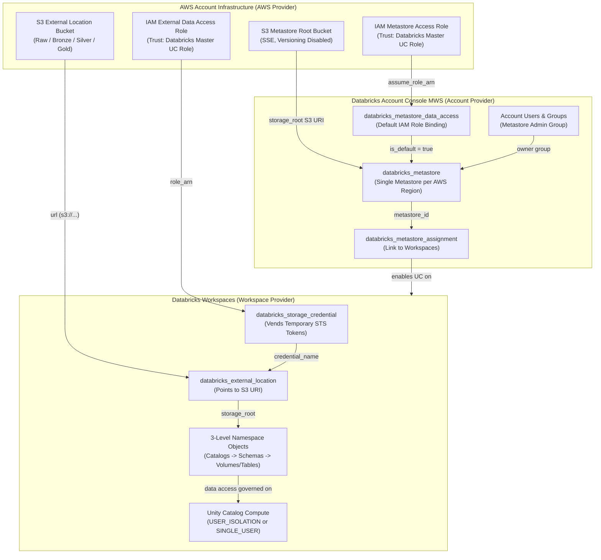

# Deploying Databricks Unity Catalog on AWS with Terraform

This skill provides comprehensive architectural patterns, production recipes, and operational guardrails for provisioning and managing **Databricks Unity Catalog on AWS** using Terraform and the official Databricks and AWS providers.

---

## 1. Authoritative Sources of Truth

Every architectural decision, resource definition, and authentication scheme must be strictly aligned with these authoritative sources:

- **Databricks Unity Catalog Getting Started Guide**:
  [Get Started with Unity Catalog | Databricks on AWS](https://docs.databricks.com/aws/en/data-governance/unity-catalog/get-started)
  *Official foundational guide for setting up Unity Catalog, configuring admin roles, workspaces, users, compute isolation, and data governance capabilities.*
- **Databricks Automated Unity Catalog Setup with Terraform**:
  [Automate Unity Catalog Setup with Terraform | Databricks on AWS](https://docs.databricks.com/aws/en/dev-tools/terraform/automate-uc)
  *Official guide outlining requirements, IAM roles, S3 buckets, environment variables, validation tips, and execution lifecycle for Terraform-driven UC automation.*
- **Databricks Terraform Provider Unity Catalog Guide**:
  [Unity Catalog Setup on AWS | Databricks Terraform Provider Documentation](https://registry.terraform.io/providers/databricks/databricks/latest/docs/guides/unity-catalog)
  *Definitive resource reference and step-by-step Terraform guide for metastores, storage credentials, external locations, catalogs, schemas, and grants.*
- **Databricks AWS Unity Catalog Terraform Example Module**:
  [Databricks AWS UC Terraform Module Example](https://registry.terraform.io/modules/databricks/examples/databricks/latest/examples/aws-databricks-uc)
  *Official Terraform registry module example demonstrating end-to-end AWS and Databricks resource orchestration.*
- **Databricks Terraform Examples Repository (`aws-databricks-uc`)**:
  [Databricks Terraform Examples Repository - aws-databricks-uc](https://github.com/databricks/terraform-databricks-examples/tree/v0.2.28/examples/aws-databricks-uc)
  *Official source implementation covering account-level identities, S3 metastore buckets, cross-account IAM trust policies, storage credentials, metastore assignment, and workspace catalogs.*

---

## 2. Architectural Principles: Unity Catalog on AWS

Unity Catalog is the universal governance layer for data and AI in Databricks. On AWS, Unity Catalog enforces fine-grained access control, auditing, data lineage, and credential vending through a tightly orchestrated cloud integration model:



### Core Architecture Guardrails

1. **The 3-Level Namespace**:
   All data assets are addressed via `catalog.schema.table` (or `catalog.schema.volume`).
   - **Catalog**: Top-level logical boundary for isolation (e.g. `dev`, `staging`, `prod`, or business domain).
   - **Schema** (Database): Organizes tables, views, volumes, and functions.
   - **Table / Volume**: Structured Delta tables or unstructured file volumes.

2. **Single Metastore per Region Limit**:
   Databricks strictly enforces **one Unity Catalog metastore per AWS region per Databricks account**. All workspaces in the same region bind to that regional metastore via `databricks_metastore_assignment`.

3. **Separation of Metastore Root and Catalog Storage Roots**:
   - **Metastore Root S3 Bucket**: Stores metastore-level metadata, system tables, and default catalog data if no catalog storage root is specified.
   - **Isolated Catalog Storage Roots**: Enterprise production environments must configure separate S3 buckets (or distinct prefixes) and distinct IAM roles for individual catalogs using `storage_root = "s3://<bucket>/<catalog-path>"`. This isolates failure domains and enforces strict cloud-level storage boundaries between environments (e.g., dev, test, prod).

4. **Credential Vending Architecture**:
   Clusters and SQL Warehouses never store or receive long-lived AWS IAM access keys. Instead, Databricks validates user permissions in Unity Catalog, assumes the customer's IAM role using AWS STS, and vends short-lived, scoped credentials directly to the compute engine for direct S3 read/write operations.

---

## 3. Strict Provider Decoupling & Scoping Rule

> [!IMPORTANT]
> **Strict Multi-Provider Scoping Requirement**:
> Unity Catalog requires **two distinct provider aliases** in Terraform:
> 1. **Account-Level Provider (`databricks.mws`)**: Required for creating account users, groups, metastores, default metastore data access, and workspace assignments (`https://accounts.cloud.databricks.com`).
> 2. **Workspace-Level Provider (`databricks.workspace` or default `databricks`)**: Required for workspace-level governance objects: storage credentials, external locations, catalogs, schemas, volumes, grants, and compute clusters.

```mermaid
flowchart LR
    subgraph AccountScope ["Provider Scope: databricks.mws (Account Console)"]
        direction TB
        A1["databricks_user"]
        A2["databricks_group"]
        A3["databricks_user_role"]
        A4["databricks_metastore"]
        A5["databricks_metastore_data_access"]
        A6["databricks_metastore_assignment"]
    end

    subgraph WorkspaceScope ["Provider Scope: databricks (Workspace URL)"]
        direction TB
        W1["databricks_storage_credential"]
        W2["databricks_external_location"]
        W3["databricks_catalog"]
        W4["databricks_schema"]
        W5["databricks_volume"]
        W6["databricks_grants"]
        W7["databricks_cluster (USER_ISOLATION)"]
    end

    AccountScope -->|"Workspace ID assigned to Metastore"| WorkspaceScope
```



---

## 4. AWS Cloud Infrastructure Implementation Recipes

### A. Metastore S3 Root Storage Bucket

The metastore root bucket holds Unity Catalog metadata and default managed tables.

```hcl
resource "aws_s3_bucket" "metastore" {
  bucket        = "${var.resource_prefix}-uc-metastore"
  force_destroy = false

  tags = merge(var.tags, {
    Name = "${var.resource_prefix}-uc-metastore"
  })
}

resource "aws_s3_bucket_versioning" "metastore" {
  bucket = aws_s3_bucket.metastore.id

  versioning_configuration {
    status = "Disabled"
  }
}

resource "aws_s3_bucket_server_side_encryption_configuration" "metastore" {
  bucket = aws_s3_bucket.metastore.id

  rule {
    apply_server_side_encryption_by_default {
      sse_algorithm     = var.kms_key_arn != null ? "aws:kms" : "AES256"
      kms_master_key_id = var.kms_key_arn
    }
  }
}

resource "aws_s3_bucket_public_access_block" "metastore" {
  bucket                  = aws_s3_bucket.metastore.id
  block_public_acls       = true
  block_public_policy     = true
  ignore_public_acls      = true
  restrict_public_buckets = true
}
```

---

### B. Cross-Account IAM Role & Databricks UC Trust Policy

Databricks assumes an IAM role in your AWS account to access S3. The trust policy must allow the official Databricks Unity Catalog master role with an `sts:ExternalId` condition set to your Databricks Account ID.

> [!WARNING]
> **Authoritative Databricks Master UC Role ARN**:
> - For standard AWS Commercial regions: `arn:aws:iam::414351767826:role/unity-catalog-prod-UCMasterRole-14S5ZJVKOTYTL`
> - Always prefer using the official provider data source `data.databricks_aws_unity_catalog_assume_role_policy` and `data.databricks_aws_unity_catalog_policy` to generate validated policies automatically.

```hcl
// Data source generating the assume-role trust policy for Databricks UC
data "databricks_aws_unity_catalog_assume_role_policy" "metastore" {
  aws_account_id = var.aws_account_id
  role_name      = "${var.resource_prefix}-uc-metastore-role"
  external_id    = var.databricks_account_id
}

// Data source generating the least-privilege S3 bucket policy for Databricks UC
data "databricks_aws_unity_catalog_policy" "metastore" {
  aws_account_id = var.aws_account_id
  bucket_name    = aws_s3_bucket.metastore.id
  role_name      = "${var.resource_prefix}-uc-metastore-role"
}

resource "aws_iam_policy" "metastore_access" {
  name        = "${var.resource_prefix}-uc-metastore-policy"
  description = "IAM policy granting Databricks Unity Catalog access to metastore S3 bucket"
  policy      = data.databricks_aws_unity_catalog_policy.metastore.json
  tags        = var.tags
}

resource "aws_iam_role" "metastore_access" {
  name               = "${var.resource_prefix}-uc-metastore-role"
  assume_role_policy = data.databricks_aws_unity_catalog_assume_role_policy.metastore.json
  tags               = var.tags
}

resource "aws_iam_role_policy_attachment" "metastore_access" {
  role       = aws_iam_role.metastore_access.name
  policy_arn = aws_iam_policy.metastore_access.arn
}

// Propagation delay mitigation to avoid MALFORMED_REQUEST race condition
resource "time_sleep" "iam_propagation" {
  depends_on      = [aws_iam_role_policy_attachment.metastore_access]
  create_duration = "20s"
}
```

---

## 5. Databricks Account-Level Identities & Metastore Recipes

### A. Account Identities & Metastore Ownership

> [!CAUTION]
> **Do Not Run Terraform as Account Owner**:
> The `account owner` cannot be managed or deleted by Terraform, and running Terraform as the owner introduces state locking and destruction issues. Always authenticate Terraform using a dedicated **Account Admin Service Principal** via OAuth M2M (`DATABRICKS_CLIENT_ID`, `DATABRICKS_CLIENT_SECRET`).

```hcl
// Metastore Administrator Group
resource "databricks_group" "metastore_admins" {
  provider     = databricks.mws
  display_name = var.unity_admin_group
}

// Provision account users
resource "databricks_user" "users" {
  provider  = databricks.mws
  for_each  = toset(concat(var.databricks_users, var.databricks_metastore_admins))
  user_name = each.key
  force     = true
}

// Assign admins to the admin group
resource "databricks_group_member" "admin_members" {
  provider  = databricks.mws
  for_each  = toset(var.databricks_metastore_admins)
  group_id  = databricks_group.metastore_admins.id
  member_id = databricks_user.users[each.value].id
}

// Elevate designated users to account admins
resource "databricks_user_role" "account_admin" {
  provider = databricks.mws
  for_each = toset(var.databricks_metastore_admins)
  user_id  = databricks_user.users[each.value].id
  role     = "account_admin"
}
```

---

### B. Metastore Creation & Workspace Assignment

```hcl
// Unity Catalog Metastore (One per AWS Region)
resource "databricks_metastore" "this" {
  provider      = databricks.mws
  name          = var.metastore_name
  region        = var.aws_region
  storage_root  = "s3://${aws_s3_bucket.metastore.id}/metastore"
  owner         = databricks_group.metastore_admins.display_name
  force_destroy = false

  depends_on = [
    databricks_group.metastore_admins,
    databricks_group_member.admin_members,
    databricks_user_role.account_admin,
    time_sleep.iam_propagation
  ]
}

// Default Data Access binding AWS IAM role to the Metastore
resource "databricks_metastore_data_access" "this" {
  provider     = databricks.mws
  metastore_id = databricks_metastore.this.id
  name         = aws_iam_role.metastore_access.name
  is_default   = true

  aws_iam_role {
    role_arn = aws_iam_role.metastore_access.arn
  }

  depends_on = [time_sleep.iam_propagation]
}

// Assign Metastore to Workspaces
resource "databricks_metastore_assignment" "this" {
  provider             = databricks.mws
  for_each             = toset(var.databricks_workspace_ids)
  workspace_id         = each.key
  metastore_id         = databricks_metastore.this.id
  default_catalog_name = var.default_catalog_name

  depends_on = [databricks_metastore_data_access.this]
}
```

---

## 6. External Storage Credentials & External Locations

To access external data or create isolated catalog storage roots, define storage credentials and external locations.

```hcl
// S3 bucket for external data (bronze/silver/gold or department storage)
resource "aws_s3_bucket" "external" {
  bucket        = "${var.resource_prefix}-uc-external"
  force_destroy = false
  tags          = var.tags
}

resource "aws_s3_bucket_public_access_block" "external" {
  bucket                  = aws_s3_bucket.external.id
  block_public_acls       = true
  block_public_policy     = true
  ignore_public_acls      = true
  restrict_public_buckets = true
}

// IAM Role for External Access
resource "aws_iam_role" "external_access" {
  name               = "${var.resource_prefix}-uc-external-role"
  assume_role_policy = data.databricks_aws_unity_catalog_assume_role_policy.external.json
  tags               = var.tags
}

// Databricks Storage Credential (Workspace-scoped)
resource "databricks_storage_credential" "external" {
  provider = databricks.workspace
  name     = aws_iam_role.external_access.name

  aws_iam_role {
    role_arn = aws_iam_role.external_access.arn
  }
  comment = "Managed by Terraform for external S3 access"

  depends_on = [time_sleep.iam_propagation]
}

// Databricks External Location binding S3 path to Storage Credential
resource "databricks_external_location" "external" {
  provider        = databricks.workspace
  name            = "${var.resource_prefix}-external-location"
  url             = "s3://${aws_s3_bucket.external.id}/data"
  credential_name = databricks_storage_credential.external.id
  comment         = "External data storage root"

  depends_on = [databricks_storage_credential.external]
}

// Grant privileges to Data Engineers
resource "databricks_grants" "external_location_grants" {
  provider          = databricks.workspace
  external_location = databricks_external_location.external.id

  grant {
    principal  = "Data Engineers"
    privileges = ["CREATE_EXTERNAL_TABLE", "READ_FILES", "WRITE_FILES"]
  }
}
```

---

## 7. 3-Level Namespace Catalog Objects & Permissions Hierarchy

```hcl
// Catalog with Dedicated Storage Root
resource "databricks_catalog" "sandbox" {
  provider      = databricks.workspace
  name          = "sandbox"
  comment       = "Sandbox catalog with isolated external S3 root"
  storage_root  = "s3://${aws_s3_bucket.external.id}/data/sandbox"
  force_destroy = false

  properties = {
    environment = var.environment
    managed_by  = "terraform"
  }

  depends_on = [databricks_external_location.external]
}

// Catalog Grants
resource "databricks_grants" "catalog_grants" {
  provider = databricks.workspace
  catalog  = databricks_catalog.sandbox.name

  grant {
    principal  = "account users"
    privileges = ["USE_CATALOG"]
  }
  grant {
    principal  = "Data Engineers"
    privileges = ["USE_CATALOG", "CREATE_SCHEMA"]
  }
}

// Schema (Database)
resource "databricks_schema" "analytics" {
  provider     = databricks.workspace
  catalog_name = databricks_catalog.sandbox.id
  name         = "analytics"
  comment      = "Analytics schema managed by Terraform"

  properties = {
    purpose = "bi-reporting"
  }
}

// Schema Grants
resource "databricks_grants" "schema_grants" {
  provider = databricks.workspace
  schema   = databricks_schema.analytics.id

  grant {
    principal  = "Data Engineers"
    privileges = ["USE_SCHEMA", "CREATE_TABLE", "CREATE_VOLUME"]
  }
}

// Volume for Unstructured Data Files
resource "databricks_volume" "raw_files" {
  provider         = databricks.workspace
  catalog_name     = databricks_catalog.sandbox.name
  schema_name      = databricks_schema.analytics.name
  name             = "raw_landing"
  volume_type      = "MANAGED"
  comment          = "Landing zone for unstructured ingestion files"
}
```

---

## 8. Unity Catalog Compute Governance

Unity Catalog enforces data governance by requiring clusters to operate in secure access modes:

### A. Shared Access Mode (`USER_ISOLATION`)
- **Use Case**: Multi-user exploratory analytics, BI queries, and collaborative notebooks.
- **Security**: Full user isolation at process and network boundaries.
- **Limitation**: Scala is unsupported; Python, SQL, and R are supported.

```hcl
data "databricks_spark_version" "latest_lts" {
  provider = databricks.workspace
  long_term_support = true
}

data "databricks_node_type" "smallest" {
  provider   = databricks.workspace
  local_disk = true
}

resource "databricks_cluster" "shared_uc" {
  provider                = databricks.workspace
  cluster_name            = "Shared-UC-Cluster"
  spark_version           = data.databricks_spark_version.latest_lts.id
  node_type_id            = data.databricks_node_type.smallest.id
  autotermination_minutes = 30
  data_security_mode      = "USER_ISOLATION"

  autoscale {
    min_workers = 1
    max_workers = 4
  }

  aws_attributes {
    availability = "SPOT_WITH_FALLBACK"
  }
}
```

### B. Single User Mode (`SINGLE_USER`)
- **Use Case**: Advanced ML workflows, custom C/C++ libraries, Machine Learning Runtime, or legacy Scala jobs.
- **Security**: Bound exclusively to a single user assigned via `single_user_name`.

```hcl
resource "databricks_cluster" "single_user" {
  provider                = databricks.workspace
  cluster_name            = "DataScientist-UC-Cluster"
  spark_version           = data.databricks_spark_version.latest_lts.id
  node_type_id            = data.databricks_node_type.smallest.id
  autotermination_minutes = 20
  data_security_mode      = "SINGLE_USER"
  single_user_name        = "data.scientist@example.com"

  num_workers = 2
}
```

---

## 9. Operational Guardrails & Troubleshooting

### A. IAM Credential Validation Race Condition
- **Symptom**: When creating `databricks_metastore_data_access` or `databricks_storage_credential`, Terraform fails with:
  `MALFORMED_REQUEST: Failed credentials validation checks ... Unable to assume role.`
- **Cause**: AWS IAM roles and policy attachments have eventual consistency propagation delay (10–30s).
- **Remediation**: Always place a `time_sleep` resource of `20s` between `aws_iam_role_policy_attachment` and Databricks data access/credential resources.

### B. Metastore Already Exists in Region
- **Symptom**: `databricks_metastore` fails with `A metastore already exists for this region`.
- **Cause**: Databricks only allows **one metastore per region per account**.
- **Remediation**: Use data source `data "databricks_metastores"` or inspect existing account metastores. If one exists, attach workspaces to the existing metastore via `databricks_metastore_assignment` rather than recreating it.

### C. Workspace Assignment Dependency Order
- **Symptom**: `databricks_catalog` fails with `Workspace not associated with any metastore`.
- **Cause**: Terraform parallel execution attempted to create catalog objects before the workspace was bound to the metastore.
- **Remediation**:
  - In single-module architectures, set resource-level `depends_on = [databricks_metastore_assignment.this]` on catalog definitions.
  - In multi-module architectures, **NEVER** use module-level `depends_on = [module.metastore_assignment]` (which triggers plan-time unknown value propagation and breaks child dynamic loops like `for_each`). Instead, establish a data-flow dependency: export `output "metastore_id"` in `modules/04.unity_catalog/002.metastore_assignment/outputs.tf` with an output-level `depends_on = [databricks_metastore_assignment.this]`, and pass `metastore_id = module.metastore_assignment.metastore_id` into downstream modules.

### D. Avoid Account Owner in Automation
- **Symptom**: State lock or permission errors when modifying admin groups.
- **Remediation**: Never use the `account owner` personal identity for Terraform pipelines. Use a dedicated Databricks Service Principal with the `account_admin` role and OAuth M2M credentials.
