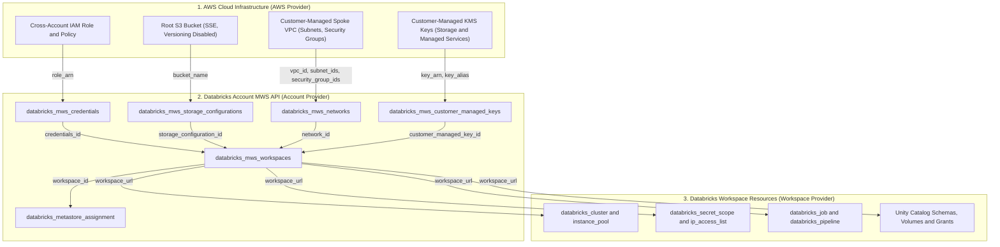

# Building Databricks Workspaces on AWS with Terraform

This skill provides comprehensive architectural patterns, production recipes, and operational guardrails for provisioning and managing **Databricks Workspaces on AWS** using Terraform and the official Databricks provider.

---

## 1. Authoritative Sources of Truth

Every architectural decision, resource definition, and authentication scheme must be strictly aligned with these authoritative sources:

- **Databricks AWS Workspace Provisioning Guide**:
  [Databricks AWS Workspace Terraform Guide](https://registry.terraform.io/providers/databricks/databricks/latest/docs/guides/aws-workspace#databricks-workspace)
  *Official step-by-step guide for deploying Databricks E2 workspaces with VPC, root S3 bucket, cross-account IAM role, and provider authentication.*
- **Databricks on AWS Workspace Administration Guide**:
  [Databricks on AWS Workspace Administration](https://docs.databricks.com/aws/en/admin/workspace/)
  *Primary documentation for workspace lifecycle, selecting between Classic and Serverless workspaces, account console configuration, and operational governance.*
- **Databricks Terraform Provider Official Registry Documentation**:
  [Databricks Terraform Provider Documentation](https://registry.terraform.io/providers/databricks/databricks/latest/docs)
  *Definitive resource schema and argument reference for all `databricks_*` and `databricks_mws_*` resources and data sources.*
- **Databricks Cloud Automation Best Practices (Part 3)**:
  [Automate Databricks on AWS: Best Practices | Databricks Blog](https://www.databricks.com/blog/best-practices-and-guidance-cloud-engineers-deploy-databricks-aws-part-3)
  *Architectural foundation detailing the 3-tier API endpoint deployment flow, modularization strategies, Service Principal OAuth authentication, and automation guardrails.*
- **Databricks Customer-Managed VPC Guide**:
  [Databricks Customer-Managed VPC Configuration](https://docs.databricks.com/aws/en/administration-guide/cloud-configurations/aws/customer-managed-vpc)
  *Requirements for subnet sizing, routing tables, security groups, and VPC endpoints.*
- **Databricks Hub & Spoke Firewall Architecture**:
  [AWS E2 Firewall Hub and Spoke Guide](https://github.com/databricks/terraform-provider-databricks/blob/main/docs/guides/aws-e2-firewall-hub-and-spoke.md)
  *Enterprise architecture reference for centralized egress filtering via AWS Network Firewall and AWS Transit Gateway.*
- **Databricks AWS PrivateLink Workspace Terraform Guide**:
  [Databricks AWS PrivateLink Workspace Guide](https://registry.terraform.io/providers/databricks/databricks/latest/docs/guides/aws-private-link-workspace)
  *Imperative source of truth for provisioning Databricks and AWS resources needed for private connectivity between the data plane and control plane, including VPC endpoint registration (`databricks_mws_vpc_endpoint`), private access settings (`databricks_mws_private_access_settings`), customer-managed network VPC endpoint associations (`databricks_mws_networks`), and private workspace provisioning.*
- **Databricks Classic PrivateLink & Control Plane Connectivity Guide**:
  [Databricks Classic Private Connectivity Documentation](https://docs.databricks.com/aws/en/security/network/classic/privatelink)
  *Imperative source of truth for configuring AWS PrivateLink for classic compute plane back-end private connectivity to Databricks control plane services, covering workspace REST API and secure cluster connectivity relay VPC endpoint requirements, private access settings, DNS configuration, and security isolation.*

---

## 2. Architectural Principles: The 3-Tier API Lifecycle

Deploying Databricks on AWS follows a strict top-to-bottom **3-Tier API Lifecycle**:



---

## 3. Strict Provider Scoping & Module Decoupling Rule

> [!IMPORTANT]
> **Strict Modular Decoupling Requirement**: Code that provisions the workspace (Account-level `provider = databricks.mws`) and code that manages resources inside the workspace (Workspace-level `provider = databricks`) **must reside in separate Terraform modules or distinct state boundaries**.

- **Why**: Initializing the workspace provider requires `host = module.workspace.workspace_url`. If workspace creation and internal resource configuration are in the same module without separation, Terraform will attempt to read workspace data sources prior to workspace creation, raising `default auth: cannot configure default credentials` or cyclical dependency errors.
- **Pattern**:
  1. Module `workspace_provisioning`: Configures `provider = databricks.mws` and outputs `workspace_url` and `workspace_id`.
  2. Module `workspace_configuration`: Consumes `workspace_url` as an input and initializes `provider = databricks` with `host = var.workspace_url`.

---

## 4. Workspace Types & Decision Framework

### A. Classic Workspaces (Customer-Managed VPC)
- **Deployment Mode**: Default when `compute_mode` is omitted or set to null.
- **Requirements**:
  - `credentials_id` (`databricks_mws_credentials`)
  - `storage_configuration_id` (`databricks_mws_storage_configurations`)
  - `network_id` (`databricks_mws_networks`) — Customer-Managed VPC
- **Use Cases**:
  - Enterprise environments requiring centralized egress filtering (Hub & Spoke via AWS Network Firewall / Transit Gateway).
  - Private data plane connectivity to on-premises systems via Direct Connect or VPN.
  - Legacy Spark RDD, Scala, or R workloads.
  - Custom VPC endpoints (S3, STS, Kinesis) to keep all cluster traffic on AWS private network backbones.

### B. Serverless Workspaces
- **Deployment Mode**: Explicitly specified with `compute_mode = "SERVERLESS"`.
- **Requirements**:
  - `account_id`
  - `workspace_name`
  - `aws_region`
  - `compute_mode = "SERVERLESS"`
- **Critical Constraints**:
  - **Must NOT** include `credentials_id` or `storage_configuration_id`. Providing either will cause a 400 API validation failure.
- **Use Cases**:
  - BI and analytics workloads (Genie One, AI/BI dashboards, Databricks Apps).
  - Instant serverless SQL warehouses and serverless Lakeflow pipelines.
  - Turnkey data intelligence workloads without dedicated VPC maintenance.

---

## 5. Production Terraform Implementation Recipes

### A. Provider Authentication Configuration

Use Service Principal OAuth M2M credentials (`client_id` and `client_secret`) with the Databricks Account ID. Never use legacy personal access tokens (PAT) or individual user credentials.

```hcl
terraform {
  required_version = ">= 1.5.0"
  required_providers {
    aws = {
      source  = "hashicorp/aws"
      version = "~> 5.0"
    }
    databricks = {
      source  = "databricks/databricks"
      version = ">= 1.40.0"
    }
    time = {
      source  = "hashicorp/time"
      version = "~> 0.9"
    }
  }
}

provider "aws" {
  region = var.aws_region
}

// Account-Level provider configuration for MWS resources
provider "databricks" {
  alias         = "mws"
  host          = "https://accounts.cloud.databricks.com"
  account_id    = var.databricks_account_id
  client_id     = var.databricks_client_id
  client_secret = var.databricks_client_secret
}
```

---

### B. Cross-Account IAM Role & Policy (with Propagation Sleep)

Databricks requires an IAM role with external ID verification to assume cross-account rights into your AWS account.

> [!WARNING]
> **Credential Validation Race Condition**: AWS IAM role creation and attached policy changes take a few seconds to propagate globally. Databricks Account API validates IAM permissions immediately upon workspace creation request. If not fully propagated, the API returns:
> `Error: MALFORMED_REQUEST: Failed credentials validation checks ... (400 on /api/2.0/accounts/{UUID}/workspaces)`
> **Mandatory Mitigation**: Enforce a `time_sleep` resource of at least 10–15 seconds before workspace creation.

```hcl
// Databricks trust policy template
data "databricks_aws_assume_role_policy" "this" {
  provider    = databricks.mws
  external_id = var.databricks_account_id
}

resource "aws_iam_role" "cross_account_role" {
  name               = "${var.resource_prefix}-crossaccount-role"
  assume_role_policy = data.databricks_aws_assume_role_policy.this.json
  tags               = var.tags
}

// Databricks cross-account permission policy template
data "databricks_aws_crossaccount_policy" "this" {
  provider    = databricks.mws
  policy_type = "customer"
}

resource "aws_iam_role_policy" "cross_account_policy" {
  name   = "${var.resource_prefix}-crossaccount-policy"
  role   = aws_iam_role.cross_account_role.id
  policy = data.databricks_aws_crossaccount_policy.this.json
}

// Register cross-account credential with Databricks Account
resource "databricks_mws_credentials" "this" {
  provider         = databricks.mws
  account_id       = var.databricks_account_id
  role_arn         = aws_iam_role.cross_account_role.arn
  credentials_name = "${var.resource_prefix}-credentials"
  depends_on       = [aws_iam_role_policy.cross_account_policy]
}

// Propagation delay mitigation
resource "time_sleep" "iam_propagation" {
  depends_on      = [aws_iam_role_policy.cross_account_policy]
  create_duration = "15s"
}
```

---

### C. DBFS Root S3 Storage Bucket & Security Configuration

The root S3 bucket stores DBFS workspace system data, cluster logs, and workspace notebooks (unless Customer-Managed Keys are configured).

```hcl
resource "aws_s3_bucket" "root_storage_bucket" {
  bucket        = "${var.resource_prefix}-rootbucket"
  force_destroy = false
  tags          = merge(var.tags, { Name = "${var.resource_prefix}-rootbucket" })
}

resource "aws_s3_bucket_server_side_encryption_configuration" "root_storage" {
  bucket = aws_s3_bucket.root_storage_bucket.id

  rule {
    apply_server_side_encryption_by_default {
      sse_algorithm = "AES256"
    }
  }
}

resource "aws_s3_bucket_public_access_block" "root_storage" {
  bucket                  = aws_s3_bucket.root_storage_bucket.id
  block_public_acls       = true
  block_public_policy     = true
  ignore_public_acls      = true
  restrict_public_buckets = true
}

// DBFS Root bucket versioning MUST be Disabled
resource "aws_s3_bucket_versioning" "root_storage" {
  bucket = aws_s3_bucket.root_storage_bucket.id
  versioning_configuration {
    status = "Disabled"
  }
}

// Databricks Bucket Policy Template
data "databricks_aws_bucket_policy" "this" {
  bucket = aws_s3_bucket.root_storage_bucket.bucket
}

resource "aws_s3_bucket_policy" "root_storage" {
  bucket     = aws_s3_bucket.root_storage_bucket.id
  policy     = data.databricks_aws_bucket_policy.this.json
  depends_on = [aws_s3_bucket_public_access_block.root_storage]
}

// Register storage configuration in Databricks Account
resource "databricks_mws_storage_configurations" "this" {
  provider                   = databricks.mws
  account_id                 = var.databricks_account_id
  bucket_name                = aws_s3_bucket.root_storage_bucket.bucket
  storage_configuration_name = "${var.resource_prefix}-storage-config"
  depends_on                 = [aws_s3_bucket_policy.root_storage]
}
```

---

### D. Customer-Managed VPC, Security Group & Network Registration

Databricks compute clusters run inside a Customer-Managed VPC (Spoke VPC). Subnets must be across at least 2 Availability Zones and dedicated to Databricks compute.

#### Security Group Rules
- **Ingress**: Must allow all internal TCP and UDP traffic between instances within the security group (`self = true`).
- **Egress**: Must allow outbound traffic on port 443 (HTTPS) and port 6666 (Secure Cluster Connectivity relay), or open egress (`0.0.0.0/0`) through the Transit Gateway and Network Firewall.

```hcl
resource "aws_security_group" "spoke_sg" {
  name        = "${var.resource_prefix}-databricks-sg"
  description = "Security group for Databricks compute in Spoke VPC"
  vpc_id      = var.spoke_vpc_id

  ingress {
    description = "Allow all internal TCP and UDP cluster communications"
    from_port   = 0
    to_port     = 65535
    protocol    = "tcp"
    self        = true
  }

  ingress {
    description = "Allow all internal UDP cluster communications"
    from_port   = 0
    to_port     = 65535
    protocol    = "udp"
    self        = true
  }

  egress {
    description = "Allow outbound egress to Databricks control plane and AWS services"
    from_port   = 0
    to_port     = 0
    protocol    = "-1"
    cidr_blocks = ["0.0.0.0/0"]
  }

  tags = merge(var.tags, { Name = "${var.resource_prefix}-databricks-sg" })
}

resource "databricks_mws_networks" "this" {
  provider           = databricks.mws
  account_id         = var.databricks_account_id
  network_name       = "${var.resource_prefix}-network"
  vpc_id             = var.spoke_vpc_id
  subnet_ids         = var.spoke_private_subnet_ids
  security_group_ids = [aws_security_group.spoke_sg.id]
}
```

> [!TIP]
> **VPC Endpoints Optimization**: Always deploy AWS VPC Endpoints for S3 (Gateway), STS (Interface), and Kinesis (Interface) in the Spoke VPC. This ensures intra-region cluster traffic routes securely over the AWS backbone without incurring NAT Gateway data processing charges or public transit latency.

---

### E. Customer-Managed Keys (CMK) for Encryption

Databricks supports dual Customer-Managed Keys (CMK) via AWS KMS:
1. `MANAGED_SERVICES`: Encrypts notebooks, secrets, queries, and metadata in the control plane.
2. `STORAGE`: Encrypts DBFS storage bucket and cluster EBS volumes.

> [!IMPORTANT]
> **KMS Key Policy Requirements**: For Databricks to use your KMS keys, the KMS key policy must grant `kms:Encrypt`, `kms:Decrypt`, `kms:ReEncrypt*`, `kms:GenerateDataKey*`, `kms:DescribeKey`, and `kms:CreateGrant` to both:
> 1. The Databricks cross-account IAM role (`aws_iam_role.cross_account_role.arn`).
> 2. The Databricks service principal root ARN: `arn:aws:iam::414351767826:root`.

```hcl
resource "databricks_mws_customer_managed_keys" "managed_services" {
  count      = var.enable_cmk ? 1 : 0
  provider   = databricks.mws
  account_id = var.databricks_account_id
  aws_key_info {
    key_arn   = var.managed_services_kms_key_arn
    key_alias = var.managed_services_kms_key_alias
  }
  use_cases = ["MANAGED_SERVICES"]
}

resource "databricks_mws_customer_managed_keys" "storage" {
  count      = var.enable_cmk ? 1 : 0
  provider   = databricks.mws
  account_id = var.databricks_account_id
  aws_key_info {
    key_arn   = var.storage_kms_key_arn
    key_alias = var.storage_kms_key_alias
  }
  use_cases = ["STORAGE"]
}
```

---

### F. AWS PrivateLink Integration for Control Plane Private Connectivity

For enterprise deployments requiring private transit between compute clusters on the data plane and core services on the control plane, adhere strictly to the [Databricks AWS PrivateLink Workspace Guide](https://registry.terraform.io/providers/databricks/databricks/latest/docs/guides/aws-private-link-workspace) and [Databricks Classic Private Connectivity Documentation](https://docs.databricks.com/aws/en/security/network/classic/privatelink).

```hcl
// 1. AWS VPC Interface Endpoints for Databricks Control Plane Services
resource "aws_vpc_endpoint" "backend_rest" {
  count               = var.enable_privatelink ? 1 : 0
  vpc_id              = var.spoke_vpc_id
  service_name        = var.workspace_vpce_service // e.g. com.amazonaws.vpce.<region>.k8s-workspace
  vpc_endpoint_type   = "Interface"
  security_group_ids  = [aws_security_group.privatelink_sg[0].id]
  subnet_ids          = var.privatelink_subnet_ids
  private_dns_enabled = true
  tags                = merge(var.tags, { Name = "${var.resource_prefix}-rest-vpce" })
}

resource "aws_vpc_endpoint" "backend_relay" {
  count               = var.enable_privatelink ? 1 : 0
  vpc_id              = var.spoke_vpc_id
  service_name        = var.relay_vpce_service // e.g. com.amazonaws.vpce.<region>.k8s-tunnel
  vpc_endpoint_type   = "Interface"
  security_group_ids  = [aws_security_group.privatelink_sg[0].id]
  subnet_ids          = var.privatelink_subnet_ids
  private_dns_enabled = true
  tags                = merge(var.tags, { Name = "${var.resource_prefix}-relay-vpce" })
}

// 2. Databricks Account MWS VPC Endpoint Registrations
resource "databricks_mws_vpc_endpoint" "backend_rest" {
  count               = var.enable_privatelink ? 1 : 0
  provider            = databricks.mws
  account_id          = var.databricks_account_id
  aws_vpc_endpoint_id = aws_vpc_endpoint.backend_rest[0].id
  vpc_endpoint_name   = "${var.resource_prefix}-vpce-backend-rest"
  region              = var.aws_region
}

resource "databricks_mws_vpc_endpoint" "backend_relay" {
  count               = var.enable_privatelink ? 1 : 0
  provider            = databricks.mws
  account_id          = var.databricks_account_id
  aws_vpc_endpoint_id = aws_vpc_endpoint.backend_relay[0].id
  vpc_endpoint_name   = "${var.resource_prefix}-vpce-backend-relay"
  region              = var.aws_region
}

// 3. Databricks Account MWS Private Access Settings (PAS)
resource "databricks_mws_private_access_settings" "pas" {
  count                        = var.enable_privatelink ? 1 : 0
  provider                     = databricks.mws
  account_id                   = var.databricks_account_id
  private_access_settings_name = "${var.resource_prefix}-pas"
  region                       = var.aws_region
  public_access_enabled        = true
  private_access_level         = "ACCOUNT"
}

// 4. Databricks MWS Customer-Managed Network with Attached VPC Endpoints
resource "databricks_mws_networks" "privatelink_network" {
  count              = var.enable_privatelink ? 1 : 0
  provider           = databricks.mws
  account_id         = var.databricks_account_id
  network_name       = "${var.resource_prefix}-privatelink-network"
  vpc_id             = var.spoke_vpc_id
  subnet_ids         = var.spoke_private_subnet_ids
  security_group_ids = [aws_security_group.spoke_sg.id]

  vpc_endpoints {
    rest_api        = [databricks_mws_vpc_endpoint.backend_rest[0].vpc_endpoint_id]
    dataplane_relay = [databricks_mws_vpc_endpoint.backend_relay[0].vpc_endpoint_id]
  }
}
```

---

### G. Workspace Provisioning (`databricks_mws_workspaces`)

#### 1. Classic Workspace Recipe
```hcl
resource "databricks_mws_workspaces" "classic" {
  provider       = databricks.mws
  account_id     = var.databricks_account_id
  aws_region     = var.aws_region
  workspace_name = "${var.resource_prefix}-classic"

  // Credentials, Storage, and Network associations
  credentials_id           = databricks_mws_credentials.this.credentials_id
  storage_configuration_id = databricks_mws_storage_configurations.this.storage_configuration_id
  network_id               = databricks_mws_networks.this.network_id

  // Optional CMK Encryption
  managed_services_customer_managed_key_id = var.enable_cmk ? databricks_mws_customer_managed_keys.managed_services[0].customer_managed_key_id : null
  storage_customer_managed_key_id          = var.enable_cmk ? databricks_mws_customer_managed_keys.storage[0].customer_managed_key_id : null

  // Optional PrivateLink PAS
  private_access_settings_id = var.enable_privatelink ? databricks_mws_private_access_settings.pas[0].private_access_settings_id : null

  // Optional Custom Tags applied automatically to all clusters
  custom_tags = var.custom_tags

  // Ensure IAM propagation time_sleep is respected
  depends_on = [time_sleep.iam_propagation]
}
```

#### 2. Serverless Workspace Recipe
```hcl
// NOTE: Must NOT pass credentials_id or storage_configuration_id
resource "databricks_mws_workspaces" "serverless" {
  provider       = databricks.mws
  account_id     = var.databricks_account_id
  aws_region     = var.aws_region
  workspace_name = "${var.resource_prefix}-serverless"
  compute_mode   = "SERVERLESS"

  custom_tags = var.custom_tags
}
```

---

### H. Unity Catalog Metastore Assignment

Assign the newly provisioned workspace to the regional Unity Catalog Metastore:

```hcl
resource "databricks_metastore_assignment" "this" {
  count                = var.unity_catalog_metastore_id != null ? 1 : 0
  provider             = databricks.mws
  workspace_id         = databricks_mws_workspaces.classic.workspace_id
  metastore_id         = var.unity_catalog_metastore_id
  default_catalog_name = "main"
}

output "workspace_url" {
  description = "The URL of the created Databricks workspace"
  value       = databricks_mws_workspaces.classic.workspace_url
}

output "workspace_id" {
  description = "The canonical ID of the created Databricks workspace"
  value       = databricks_mws_workspaces.classic.workspace_id
}
```

---

### I. Workspace Post-Creation Configuration Module (Downstream)

In a separate downstream module/state, configure the workspace-level provider:

```hcl
provider "databricks" {
  host          = module.workspace_provisioning.workspace_url
  client_id     = var.databricks_client_id
  client_secret = var.databricks_client_secret
}

// Safe data source invocation with explicit workspace dependency
data "databricks_current_user" "me" {}

// Workspace-level IP access lists, cluster policies, and catalog assignments
resource "databricks_cluster_policy" "standard" {
  name       = "enterprise-standard-policy"
  definition = jsonencode({
    "spark_conf.spark.databricks.cluster.profile": {
      "type": "fixed",
      "value": "singleNode",
      "hidden": true
    }
  })
}
```

---

## 6. Common Pitfalls & Troubleshooting Guide

| Issue / Error | Root Cause | Solution |
| :--- | :--- | :--- |
| `MALFORMED_REQUEST: Failed credentials validation checks` (400) | AWS IAM role/policy was just created and has not propagated across AWS regional endpoints when Databricks validates it. | Add `time_sleep` of `15s` between `aws_iam_role_policy` and `databricks_mws_workspaces`. |
| `Cannot configure default credentials` / lazy auth error | Data sources in workspace module called before workspace is active. | Separate workspace creation from workspace management into different modules. |
| `More than one authorization method configured` | Multiple conflicting auth attributes present in provider block or environment variables. | Use only OAuth Service Principal (`client_id`, `client_secret`, `account_id`). Unset `DATABRICKS_TOKEN`. |
| `Updating networks on running workspace` failure | Modifying `network_id` on an active workspace cannot be done in a single apply step. | Follow Databricks documented 3-step migration: update network, re-register, and swap. |
| `S3 Bucket versioning status` error | DBFS root bucket does not support versioning. | Ensure `aws_s3_bucket_versioning` sets `status = "Disabled"`. |
| `Subnet CIDR overlap / exhaustion` | Compute subnets too small for cluster autoscaling. | Size private subnets to at least `/26` per AZ (recommended `/24` or `/22` for production). |
| `KMS Access Denied during Workspace Provisioning` | KMS Key policy does not trust Databricks cross-account role or Databricks service principal ARN. | Add `arn:aws:iam::414351767826:root` and cross-account role ARN to KMS key policy with `kms:Decrypt`, `kms:GenerateDataKey*`, `kms:CreateGrant`. |

---

## 7. Related Skills & Project References

- **[databricks-docs](../databricks-docs/SKILL.md)** - Databricks documentation index lookup via `llms.txt`.
- **Hub & Spoke Network Spoke VPC**: `modules/01.networking/002.spoke_vpc` - Provisions the customer-managed VPC and subnets used by `databricks_mws_networks`.
- **KMS Key Management**: `modules/02.security/001.kms_key` - Provisions CMK keys for `databricks_mws_customer_managed_keys`.
- **State Storage Bucket**: `modules/03.storage/001.env_backend_bucket` - Remote state bucket configuration.
