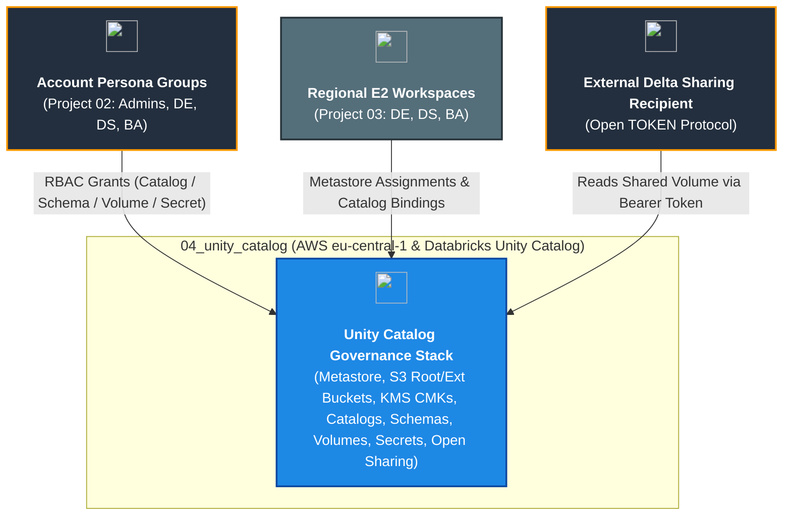
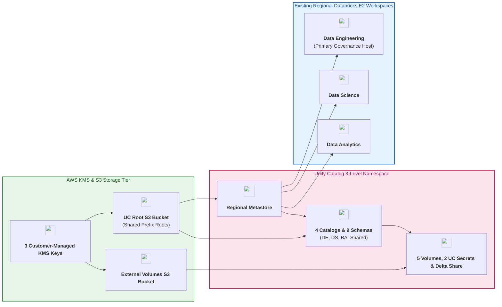

# Databricks Unity Catalog Governance Deployment on AWS (`04_unity_catalog`)

[](https://developer.hashicorp.com/terraform/docs)
[](https://registry.terraform.io/providers/hashicorp/aws/latest/docs)
[](https://registry.terraform.io/providers/databricks/databricks/latest/docs)
[](https://docs.databricks.com/aws/en/data-governance/unity-catalog/)
[](https://pre-commit.com/)

---

## 1. Executive Summary

- **Purpose & Scope**:
  This repository (`04_unity_catalog`) is the fourth foundational pillar of the enterprise **Databricks on AWS Deployment** suite:
  1. `01_setup_vpc_networking` — Centralized Hub-and-Spoke VPC & AWS Network Firewall inspection.
  2. `02_setup_identity_management` — Account-level users, SCIM persona groups (`dbx-platform-admins`, `dbx-data-engineers`, `dbx-data-scientists`, `dbx-data-analysts`), and OAuth service principals.
  3. `03_workspaces_and_compute_management` — Domain-isolated E2 Workspaces (`data_engineering`, `data_science`, `data_analytics`), cluster policies, compute clusters, and SQL warehouses.
  4. **`04_unity_catalog` (This Repository)** — Regional **Unity Catalog Metastore**, hardened S3 root & external storage buckets, customer-managed KMS keys, multi-workspace metastore assignments, domain-isolated and shared catalogs with workspace bindings, 9 medallion/domain schemas, `MANAGED` and `EXTERNAL` volumes, native Unity Catalog secrets (`databricks_secret_uc`), workspace secret scopes, and Open Delta Sharing.
- **Architectural Highlights**:
  - **Shared UC Root Bucket with Prefix Isolation**: Uses a single hardened S3 root bucket (`msedek-dbx-dep-uc-metastore-root-dev`) encrypted with its own customer-managed KMS key (`uc_root`), allocating distinct S3 prefixes per catalog (`s3://<bucket>/catalogs/<domain>`) rather than proliferating separate S3 buckets per catalog.
  - **Non-Overlapping External Volume Architecture**: Provisions a dedicated S3 bucket (`msedek-dbx-dep-uc-ext-volumes-dev`) and KMS key (`uc_external_volumes`) for `EXTERNAL` volumes, satisfying Databricks Unity Catalog's strict path non-overlap rule while defaulting internal workloads to `MANAGED` volumes.
  - **Dynamic Governance Discovery**: Automatically resolves the primary governance workspace URL via `data.databricks_current_user.data_engineering.workspace_url` with optional variable fallback, eliminating hardcoded URLs.
  - **Native Unity Catalog Secrets (`databricks_secret_uc`)**: Stores secrets directly in the 3-level namespace (`<catalog>.<schema>.<secret_name>`) with `READ_SECRET` RBAC grants, alongside optional workspace secret scopes addressed using non-sensitive SHA256 composite keys.
  - **Zero Extra Compute Clusters**: Executes all governance operations via the account-level (`databricks.mws`) and workspace-level (`databricks.workspace`) REST APIs without provisioning any extra compute clusters.
  - **Open Delta Sharing**: Configures the metastore with `delta_sharing_scope = "INTERNAL_AND_EXTERNAL"` and provisions an Open Delta Share (`databricks_share`) and external `TOKEN` recipient (`databricks_recipient`).
  - **Data-Flow Dependency Mandate**: Strictly adheres to HashiCorp best practices by avoiding module-level `depends_on = [module.<name>]` in favor of fine-grained output-level and variable-based data dependencies.

---

## 2. General Logic & Operational Flow

### 2.1 End-to-End Provisioning Sequence
1. **Cryptographic & State Foundation (`001.kms_key`, `001.env_backend_bucket`)**: Provisions CMKs with annual key rotation and `prevent_destroy = true` for the Terraform state backend, UC root bucket, and external volumes bucket.
2. **Unity Catalog S3 Storage (`002.uc_root_bucket`)**: Provisions hardened S3 buckets with `BucketOwnerEnforced`, 100% public access block, SSE-KMS with S3 Bucket Keys, S3 Versioning `Disabled` (per Databricks Delta Lake best practice), and 7-day incomplete multipart upload cleanup.
3. **Regional Metastore & IAM Trust (`001.metastore`)**: Generates the self-assuming IAM trust policy (`ExternalId = var.databricks_account_id`) and least-privilege S3/KMS policy, attaches an `aws_kms_grant`, waits 30 seconds (`time_sleep`) for IAM eventual consistency, and creates `databricks_metastore` and `databricks_metastore_data_access`.
4. **Workspace Assignment (`002.metastore_assignment`)**: Dynamically discovers existing regional workspaces (`data.databricks_mws_workspaces.all`), attaches them to the metastore, and exports `metastore_id` as an encapsulated data-flow gate.
5. **3-Level Namespace & Open Sharing (`003.catalogs` $\rightarrow$ `004.schemas` $\rightarrow$ `005.volumes`, `002.uc_secrets`, `006.open_sharing`)**: Provisions 4 catalogs, workspace bindings (`READ_WRITE` / `READ_ONLY`), 9 schemas, 5 managed/external volumes, 2 UC secrets, 1 workspace secret scope, Delta Sharing share/recipient, and authoritative `databricks_grants`.

---

## 3. Architecture of the Project

### 3.1 Repository Structure

```text
04_unity_catalog/
├── .ai/
│   ├── instructions.md               # Authoritative engineering & security rules
│   └── README_TEMPLATE.md            # Standard README template
├── .github/
│   ├── copilot-instructions.md       # Authoritative GitHub Copilot engineering & security instructions
│   ├── mcp/                          # Model Context Protocol server configurations
│   ├── skills/                       # Vendored AI skills & architectural playbooks
│   └── workflows/
│       ├── deploy-dev.yml            # Root CI/CD orchestrator (Pre-commit -> Plan -> Apply)
│       ├── dpl-01-precommit.yml      # Formatting, TFLint, Gitleaks, Trivy checks
│       ├── dpl-02-plan.yml           # Speculative Terraform Plan & artifact upload
│       ├── dpl-03-apply.yml          # Gated Terraform Apply
│       └── README.md                 # CI/CD workflows documentation
├── environments/
│   └── dev/                          # Dev environment root orchestration
│       ├── backend.tf
│       ├── data.tf
│       ├── locals.tf
│       ├── main.tf
│       ├── providers.tf
│       ├── variables.tf
│       ├── README.md
│       └── TERRAFORM.md
├── modules/
│   ├── 02.security/
│   │   ├── 001.kms_key/              # Customer-managed KMS keys (state, UC root, external volumes)
│   │   └── 002.uc_secrets/           # Native UC secrets (databricks_secret_uc) & workspace scopes
│   ├── 03.storage/
│   │   ├── 001.env_backend_bucket/   # Versioned S3 bucket for Terraform remote state
│   │   └── 002.uc_root_bucket/       # Hardened S3 bucket for UC metastore root & external volumes
│   └── 04.unity_catalog/
│       ├── 001.metastore/            # Regional UC metastore, IAM role/policy, KMS grant, data access
│       ├── 002.metastore_assignment/ # Binds metastore to existing regional E2 workspaces
│       ├── 003.catalogs/             # Catalogs (shared root prefix), workspace bindings & RBAC
│       ├── 004.schemas/              # Medallion/domain schemas & authoritative RBAC grants
│       ├── 005.volumes/              # Managed & optional External volumes + external locations
│       └── 006.open_sharing/         # Open Delta Sharing shares, TOKEN recipients & grants
├── .pre-commit-config.yaml
├── .tflint.hcl
├── .trivyignore
└── README.md
```

### 3.2 Architecture Review: Designated Volumes (`MANAGED` vs. `EXTERNAL`)

| Design Dimension | `MANAGED` Volumes (Default) | `EXTERNAL` Volumes (Optional / Regulated Drop Zones) |
|:---|:---|:---|
| **Use Case** | Internal Databricks file storage: Auto Loader landing zones, MLflow/PyTorch checkpoints, BI exports, Delta Sharing file outboxes | B2B partner file drops, legacy SFTP/EventBridge producers, or files read/written directly in S3 by non-Databricks AWS services |
| **Backing S3 Bucket** | Shared UC Root Bucket (`msedek-dbx-dep-uc-metastore-root-dev`) under catalog prefix | Dedicated External Bucket (`msedek-dbx-dep-uc-ext-volumes-dev`) to prevent S3 path overlap with the metastore root |
| **Storage Credential & External Location** | Uses the Metastore's default data access IAM role automatically | Uses dedicated IAM role, KMS grant, `databricks_storage_credential`, and `databricks_external_location` provisioned by `005.volumes` |
| **Lifecycle on `DROP VOLUME`** | Unity Catalog deletes both metadata and underlying S3 objects | Unity Catalog deletes metadata only; S3 objects remain intact in the external bucket |

---

## 4. Architecture C4 Visualisation

### 4.1 Level 1: System Context Diagram



### 4.2 Level 2: Multi-Layer Governance & Storage Container Diagram



---

## 5. All Modules Used with Short Summaries

| Category | Module Directory | Source Path | Primary Role / Responsibility |
|:---|:---|:---|:---|
| **Security** | `001.kms_key` | [`modules/02.security/001.kms_key`](./modules/02.security/001.kms_key) | Customer-managed KMS keys for state backend, UC root bucket, and external volumes |
| **Security** | `002.uc_secrets` | [`modules/02.security/002.uc_secrets`](./modules/02.security/002.uc_secrets) | Native UC secrets (`databricks_secret_uc`), RBAC grants, and workspace scopes |
| **Storage** | `001.env_backend_bucket` | [`modules/03.storage/001.env_backend_bucket`](./modules/03.storage/001.env_backend_bucket) | Versioned, SSE-KMS encrypted S3 bucket for Terraform remote state |
| **Storage** | `002.uc_root_bucket` | [`modules/03.storage/002.uc_root_bucket`](./modules/03.storage/002.uc_root_bucket) | Hardened S3 bucket for UC root storage and external volumes |
| **Unity Catalog** | `001.metastore` | [`modules/04.unity_catalog/001.metastore`](./modules/04.unity_catalog/001.metastore) | Regional metastore, least-privilege IAM role/policy, KMS grant, 30s sleep, and default data access |
| **Unity Catalog** | `002.metastore_assignment` | [`modules/04.unity_catalog/002.metastore_assignment`](./modules/04.unity_catalog/002.metastore_assignment) | Attaches the regional metastore to existing Databricks workspaces; exports `metastore_id` |
| **Unity Catalog** | `003.catalogs` | [`modules/04.unity_catalog/003.catalogs`](./modules/04.unity_catalog/003.catalogs) | Creates 4 catalogs with shared-bucket S3 prefix isolation, workspace bindings, and RBAC |
| **Unity Catalog** | `004.schemas` | [`modules/04.unity_catalog/004.schemas`](./modules/04.unity_catalog/004.schemas) | Creates 9 medallion/domain schemas within catalogs and enforces schema RBAC grants |
| **Unity Catalog** | `005.volumes` | [`modules/04.unity_catalog/005.volumes`](./modules/04.unity_catalog/005.volumes) | Creates `MANAGED` and optional `EXTERNAL` volumes (plus storage credential & external location) |
| **Unity Catalog** | `006.open_sharing` | [`modules/04.unity_catalog/006.open_sharing`](./modules/04.unity_catalog/006.open_sharing) | Creates Delta Sharing share, external `TOKEN` recipient, and `SELECT` grant |

---

## 6. Deployment Runbook

### 6.1 Prerequisites
1. **Project 02 (`02_setup_identity_management`) Deployed**: Account-level groups (`dbx-platform-admins`, `dbx-data-engineers`, `dbx-data-scientists`, `dbx-data-analysts`) and the OAuth Service Principal (with Account Admin role) must exist.
2. **Project 03 (`03_workspaces_and_compute_management`) Deployed**: The 3 regional E2 workspaces (`msedek-dbx-dep-data-eng-dev`, `msedek-dbx-dep-data-science-dev`, `msedek-dbx-dep-data-analytics-dev`) must be active in `eu-central-1`.
3. **Service Principal Workspace Assignment**: Ensure the Terraform OAuth Service Principal is assigned to the primary governance workspace (`msedek-dbx-dep-data-eng-dev`) with Admin/Metastore Admin permissions.

### 6.2 Local Quality Checks & Deployment Commands

```powershell
# 1. Run pre-commit quality, linting, and security checks
.\.venv\Scripts\pre-commit.exe run --all-files

# 2. Initialize and validate the dev environment
terraform -chdir=environments/dev init
terraform -chdir=environments/dev validate

# 3. Generate a speculative execution plan
terraform -chdir=environments/dev plan -out=tfplan
```

---

## 7. Important Links and Resources

### 7.1 Authoritative Documentation
- [Databricks Unity Catalog Documentation (AWS)](https://docs.databricks.com/aws/en/data-governance/unity-catalog/)
- [Databricks Terraform Provider Unity Catalog Guide](https://registry.terraform.io/providers/databricks/databricks/latest/docs/guides/unity-catalog)
- [Secrets in Unity Catalog (`databricks_secret_uc`)](https://registry.terraform.io/providers/databricks/databricks/latest/docs/resources/secret_uc)
- [Delta Sharing on Databricks](https://docs.databricks.com/aws/en/delta-sharing/)

### 7.2 Internal References
- [Dev Environment Documentation (`environments/dev/README.md`)](./environments/dev/README.md)
- [Dev Environment Terraform Contract (`environments/dev/TERRAFORM.md`)](./environments/dev/TERRAFORM.md)
- [GitHub Actions CI/CD Documentation (`.github/workflows/README.md`)](./.github/workflows/README.md)
- [GitHub Copilot Custom Instructions (`.github/copilot-instructions.md`)](./.github/copilot-instructions.md)
- [Project Instructions & Source of Truth (`.ai/instructions.md`)](./.ai/instructions.md)
