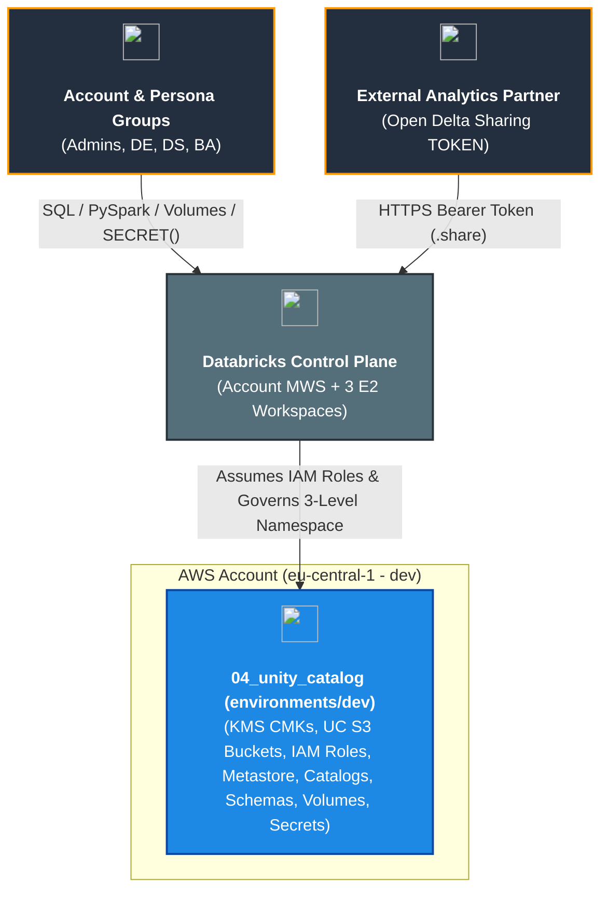

# Dev Environment — Databricks Unity Catalog Governance (`environments/dev`)

[](https://developer.hashicorp.com/terraform/docs)
[](https://registry.terraform.io/providers/hashicorp/aws/latest/docs)
[](https://registry.terraform.io/providers/databricks/databricks/latest/docs)
[](https://docs.databricks.com/aws/en/data-governance/unity-catalog/)

---

## 1. Executive Summary

- **Purpose & Scope**:
  This directory (`environments/dev`) is the root Terraform orchestration environment for deploying and governing **Databricks Unity Catalog** in the `dev` environment (`eu-central-1`). It unifies AWS cryptographic keys, hardened S3 storage buckets, the regional Unity Catalog metastore, multi-workspace assignments, domain-isolated and shared catalogs, medallion schemas, managed and external volumes, native Unity Catalog secrets, and Open Delta Sharing in a single declarative state.
- **Problem Statement & Solution**:
  Enterprise lakehouse deployments with multiple workspaces (`data_engineering`, `data_science`, `data_analytics`) require centralized metadata governance without proliferating S3 buckets per catalog or compute clusters per governance run. This environment solves this by:
  1. Discovering the 3 existing workspaces from `03_workspaces_and_compute_management` dynamically via `data.databricks_mws_workspaces.all` and binding them to a single regional metastore (`msedek-dbx-dep-metastore-eu-central-1-dev`).
  2. Dynamically resolving the primary governance workspace URL (`https://dbc-273d0704-3b96.cloud.databricks.com`) via `data.databricks_current_user.data_engineering.workspace_url` with zero hardcoding.
  3. Using a single shared Unity Catalog root S3 bucket (`msedek-dbx-dep-uc-metastore-root-dev`) with per-catalog S3 prefix roots (`s3://<bucket>/catalogs/<domain>`), plus a dedicated non-overlapping external volumes bucket (`msedek-dbx-dep-uc-ext-volumes-dev`).
  4. Executing all workspace-scoped Unity Catalog governance operations through the primary governance workspace with **zero extra compute clusters provisioned**.
- **Key Business & Security Outcomes**:
  - **End-to-End 3-Level Namespace Governance**: Governs Catalogs $\rightarrow$ Schemas $\rightarrow$ Volumes & Secrets under account-level SCIM groups (`dbx-platform-admins`, `dbx-data-engineers`, `dbx-data-scientists`, `dbx-data-analysts`).
  - **Workspace Isolation & Cross-Domain Sharing**: Enforces `ISOLATED` workspace bindings (`READ_WRITE` / `READ_ONLY`) on domain catalogs (`data_engineering_dev`, `data_science_dev`, `data_analytics_dev`) and `OPEN` access on `shared_enterprise_dev`.
  - **Customer-Managed KMS Envelope Encryption**: Separate KMS CMKs protect the Terraform backend state (`kms_key`), the UC root bucket (`extra_kms_keys["uc_root"]`), and the external volumes bucket (`extra_kms_keys["uc_external_volumes"]`).
  - **Open Delta Sharing Ready**: Publishes live curated volumes to external token-authenticated recipients (`TOKEN`) with zero data duplication.
  - **Data-Flow Dependency Mandate**: Strictly adheres to HashiCorp best practices by avoiding module-level `depends_on = [module.<name>]` in favor of fine-grained output-level and variable-based data dependencies.

---

## 2. General Logic & Operational Flow

### 2.1 Configuration & Provisioning Lifecycle
1. **Dynamic Workspace Discovery (`data.tf` & `locals.tf`)**: Queries `data.databricks_mws_workspaces.all` (using `provider = databricks.mws`) to resolve workspace names (`msedek-dbx-dep-data-eng-dev`, `msedek-dbx-dep-data-science-dev`, `msedek-dbx-dep-data-analytics-dev`) to numeric workspace IDs (`local.workspace_ids`), and discovers the governance workspace URL dynamically via `data.databricks_current_user.data_engineering.workspace_url`.
2. **State & Cryptographic Foundation**:
   - `module.kms_key` & `module.backend_bucket`: Retain the existing KMS CMK and S3 remote state bucket (`msedek-dbx-dep-unity-catalog-s3-backend-dev`).
   - `module.extra_kms_keys`: Provisions dedicated CMKs for `uc_root` and `uc_external_volumes`.
3. **S3 Storage Layer**:
   - `module.uc_root_bucket`: Provisions `msedek-dbx-dep-uc-metastore-root-dev` (shared by the metastore and all catalog `storage_root` prefixes).
   - `module.uc_external_volumes_bucket`: Provisions `msedek-dbx-dep-uc-ext-volumes-dev` (dedicated to `EXTERNAL` volumes to respect the Unity Catalog non-overlapping path rule).
4. **Account-Level Metastore & Workspace Binding**:
   - `module.metastore`: Provisions the IAM role, S3/KMS policy, KMS grant, 30s STS propagation sleep, `databricks_metastore`, and `databricks_metastore_data_access`.
   - `module.metastore_assignment`: Assigns the metastore to all 3 regional workspaces and exports `metastore_id` with an internal dependency gate.
5. **Workspace-Level 3-Level Namespace & Sharing**:
   - `module.catalogs` $\rightarrow$ `module.schemas` $\rightarrow$ `module.volumes`, `module.uc_secrets`, and `module.open_sharing`.

### 2.2 Data & Governance Plane Flow
- **Account Control Plane (`databricks.mws`)**: Authenticates to `https://accounts.cloud.databricks.com` to manage the regional metastore and workspace assignments.
- **Workspace Control Plane (`databricks.workspace`)**: Authenticates to `local.governance_workspace_url` (dynamically discovered via `data.databricks_current_user.data_engineering.workspace_url` with optional override via `var.governance_workspace_url`) to provision catalogs, workspace bindings, schemas, volumes, UC secrets, shares, recipients, and RBAC grants.

---

## 3. Architecture of the Environment

### 3.1 Catalogs, Workspace Bindings & Storage Topology

| Catalog Name | Isolation Mode | Storage Root Prefix (Shared UC Root Bucket) | Bound Workspaces (`READ_WRITE` / `READ_ONLY`) | Schemas Provisioned |
|:---|:---:|:---|:---|:---|
| `data_engineering_dev` | `ISOLATED` | `s3://msedek-dbx-dep-uc-metastore-root-dev/catalogs/data_engineering` | DE (`RW`), DS (`RO`), BA (`RO`) | `raw_ingestion`, `bronze`, `silver`, `gold` |
| `data_science_dev` | `ISOLATED` | `s3://msedek-dbx-dep-uc-metastore-root-dev/catalogs/data_science` | DS (`RW`), DE (`RO`) | `ml_artifacts`, `feature_store` |
| `data_analytics_dev` | `ISOLATED` | `s3://msedek-dbx-dep-uc-metastore-root-dev/catalogs/data_analytics` | BA (`RW`), DE (`RW`) | `bi_reporting` |
| `shared_enterprise_dev` | `OPEN` | `s3://msedek-dbx-dep-uc-metastore-root-dev/catalogs/shared_enterprise` | All Attached Workspaces (`OPEN`) | `external_sharing`, `security_vault` |

### 3.2 Volumes, Secrets & Open Sharing Inventory

| Category | Object Identifier | Type / Scope | Backing Location / Target | Authorized Principals |
|:---|:---|:---:|:---|:---|
| **Volume** | `data_engineering_dev.raw_ingestion.raw_events_landing` | `MANAGED` | Shared UC Root Bucket | `dbx-data-engineers` (RW) |
| **Volume** | `data_engineering_dev.raw_ingestion.partner_external_dropzone` | `EXTERNAL` | `s3://msedek-dbx-dep-uc-ext-volumes-dev/external-volumes/partner-dropzone` | `dbx-data-engineers` (RW), `dbx-data-scientists` (RO) |
| **Volume** | `data_science_dev.ml_artifacts.model_checkpoints` | `MANAGED` | Shared UC Root Bucket | `dbx-data-scientists` (RW), `dbx-data-engineers` (RO) |
| **Volume** | `data_analytics_dev.bi_reporting.report_exports` | `MANAGED` | Shared UC Root Bucket | `dbx-data-analysts` (RW), `dbx-data-engineers` (RW) |
| **Volume** | `shared_enterprise_dev.external_sharing.partner_data_releases` | `MANAGED` | Shared UC Root Bucket | `dbx-data-engineers` (RW), `dbx-data-analysts` (RO) + Delta Share |
| **UC Secret** | `shared_enterprise_dev.security_vault.external_ingestion_api_key` | `databricks_secret_uc` | Unity Catalog Metastore | `dbx-platform-admins` (`ALL`), `dbx-data-engineers` (`READ`), `dbx-data-scientists` (`READ`) |
| **UC Secret** | `data_engineering_dev.raw_ingestion.erp_jdbc_password` | `databricks_secret_uc` | Unity Catalog Metastore | `dbx-platform-admins` (`ALL`), `dbx-data-engineers` (`READ`) |
| **Workspace Scope** | `uc-platform-integrations-dev` | `databricks_secret_scope` | Workspace Local | `dbx-platform-admins` (`MANAGE`), `dbx-data-engineers` (`READ`) |
| **Delta Share** | `enterprise_open_share_dev` | `databricks_share` | Shares `partner_data_releases` (`VOLUME`) | `ext-analytics-partner-dev` (`TOKEN` recipient with `SELECT`) |

---

## 4. Architecture C4 Visualisation

### 4.1 Level 1: System Context Diagram



### 4.2 Level 2: Container Diagram (Storage, Metastore & Multi-Workspace Governance)

```mermaid
flowchart LR
    classDef awsSec fill:#FFF3E0,stroke:#E65100,stroke-width:2px,color:#BF360C;
    classDef awsS3 fill:#E8F5E9,stroke:#2E7D32,stroke-width:2px,color:#1B5E20;
    classDef ucGov fill:#FCE4EC,stroke:#C2185B,stroke-width:2px,color:#880E4F;
    classDef wsTier fill:#E3F2FD,stroke:#1565C0,stroke-width:2px,color:#0D47A1;

    subgraph SecurityAndStorage [\"AWS KMS & S3 Storage Layer (eu-central-1)\"]
        KMSKeys[\"<br/><b>KMS CMKs</b><br/>(Backend, UC Root, Ext Volumes)\"]
        RootBucket[\"<br/><b>Shared UC Root Bucket</b><br/>(Metastore + 4 Catalog Prefixes)\"]
        ExtBucket[\"<br/><b>External Volumes Bucket</b><br/>(Partner Drop Zone)\"]
    end
    class SecurityAndStorage awsS3;

    subgraph UnityCatalogLayer [\"Databricks Unity Catalog Metastore & 3-Level Namespace\"]\n        Metastore[\"<br/><b>Regional Metastore</b><br/>(IAM Data Access + Delta Sharing)\"]\n        Catalogs[\"<br/><b>4 Catalogs & 9 Schemas</b><br/>(ISOLATED + OPEN)\"]\n        VolumesAndSecrets[\"<br/><b>5 Volumes, UC Secrets & Delta Share</b>\"]\n    end\n    class UnityCatalogLayer ucGov;\n\n    subgraph WorkspacesLayer [\"Existing Regional Databricks E2 Workspaces\"]\n        WS_DE[\"<br/><b>Data Engineering</b><br/>(Primary Governance Host)\"]\n        WS_DS[\"<br/><b>Data Science</b>\"]\n        WS_BA[\"<br/><b>Data Analytics</b>\"]\n    end\n    class WorkspacesLayer wsTier;\n\n    KMSKeys --> RootBucket\n    KMSKeys --> ExtBucket\n    RootBucket --> Metastore\n    RootBucket --> Catalogs\n    ExtBucket --> VolumesAndSecrets\n    Metastore --> Catalogs\n    Catalogs --> VolumesAndSecrets\n    Metastore --> WS_DE\n    Metastore --> WS_DS\n    Metastore --> WS_BA\n```\n\n### 4.3 Level 3: Component Diagram (Terraform Module Orchestration)\n\n```mermaid\ngraph TD\n    classDef moduleNode fill:#ECEFF1,stroke:#455A64,stroke-width:1.5px,color:#263238;\n    classDef govNode fill:#FCE4EC,stroke:#C2185B,stroke-width:1.5px,color:#880E4F;\n\n    KmsBackend[\"<br/><b>module.kms_key</b>\"]:::moduleNode\n    BackendBucket[\"<br/><b>module.backend_bucket</b>\"]:::moduleNode\n    ExtraKms[\"<br/><b>module.extra_kms_keys</b>\"]:::moduleNode\n    UcRootBucket[\"<br/><b>module.uc_root_bucket</b>\"]:::moduleNode\n    UcExtBucket[\"<br/><b>module.uc_external_volumes_bucket</b>\"]:::moduleNode\n    Metastore[\"<br/><b>module.metastore</b>\"]:::govNode\n    Assignment[\"<br/><b>module.metastore_assignment</b>\"]:::govNode\n    Catalogs[\"<br/><b>module.catalogs</b>\"]:::govNode\n    Schemas[\"<br/><b>module.schemas</b>\"]:::govNode\n    Volumes[\"<br/><b>module.volumes</b>\"]:::govNode\n    Secrets[\"<br/><b>module.uc_secrets</b>\"]:::govNode\n    OpenSharing[\"<br/><b>module.open_sharing</b>\"]:::govNode\n\n    KmsBackend -->|\"kms_arn\"| BackendBucket\n    ExtraKms -->|\"uc_root kms_arn\"| UcRootBucket\n    ExtraKms -->|\"uc_external_volumes kms_arn\"| UcExtBucket\n    UcRootBucket -->|\"bucket_name\"| Metastore\n    ExtraKms -->|\"uc_root kms_arn\"| Metastore\n    Metastore -->|\"metastore_id\"| Assignment\n    Assignment -->|\"metastore_id (data-flow)\"| Catalogs\n    Assignment -->|\"metastore_id (data-flow)\"| Volumes\n    UcRootBucket -->|\"bucket_name\"| Catalogs\n    Catalogs -->|\"catalog_names\"| Schemas\n    Schemas -->|\"schema_names\"| Volumes\n    UcExtBucket -->|\"bucket_name\"| Volumes\n    ExtraKms -->|\"uc_external_volumes kms_arn\"| Volumes\n    Schemas -->|\"schema_names\"| Secrets\n    Volumes -->|\"volume_full_names\"| OpenSharing\n```\n\n---\n\n## 5. All Modules Used with Short Summaries\n\n### 5.1 Module Inventory Table\n\n| Module Instance | Source Path | Primary Role / Responsibility |\n|:---|:---|:---|\n| `kms_key` | [`../../modules/02.security/001.kms_key`](../../modules/02.security/001.kms_key) | Customer-managed KMS key for Terraform S3 remote state encryption |\n| `backend_bucket` | [`../../modules/03.storage/001.env_backend_bucket`](../../modules/03.storage/001.env_backend_bucket) | Versioned, SSE-KMS encrypted S3 bucket for Terraform state |\n| `extra_kms_keys` | [`../../modules/02.security/001.kms_key`](../../modules/02.security/001.kms_key) | Dedicated CMKs for Unity Catalog root bucket (`uc_root`) and external volumes (`uc_external_volumes`) |\n| `uc_root_bucket` | [`../../modules/03.storage/002.uc_root_bucket`](../../modules/03.storage/002.uc_root_bucket) | Shared Unity Catalog S3 root bucket (`msedek-dbx-dep-uc-metastore-root-dev`) |\n| `uc_external_volumes_bucket` | [`../../modules/03.storage/002.uc_root_bucket`](../../modules/03.storage/002.uc_root_bucket) | Dedicated S3 bucket (`msedek-dbx-dep-uc-ext-volumes-dev`) for `EXTERNAL` volumes |\n| `metastore` | [`../../modules/04.unity_catalog/001.metastore`](../../modules/04.unity_catalog/001.metastore) | Regional Unity Catalog metastore, IAM data access role, KMS grant, and Delta Sharing config |\n| `metastore_assignment` | [`../../modules/04.unity_catalog/002.metastore_assignment`](../../modules/04.unity_catalog/002.metastore_assignment) | Binds the regional metastore to existing DE, DS, and BA workspaces; exports `metastore_id` gate |\n| `catalogs` | [`../../modules/04.unity_catalog/003.catalogs`](../../modules/04.unity_catalog/003.catalogs) | Provisions 4 catalogs with shared-bucket S3 prefixes, workspace bindings, and RBAC grants |\n| `schemas` | [`../../modules/04.unity_catalog/004.schemas`](../../modules/04.unity_catalog/004.schemas) | Provisions 9 medallion/domain schemas and authoritative schema RBAC grants |\n| `volumes` | [`../../modules/04.unity_catalog/005.volumes`](../../modules/04.unity_catalog/005.volumes) | Provisions optional external storage credential/location and 5 `MANAGED` & `EXTERNAL` volumes |\n| `uc_secrets` | [`../../modules/02.security/002.uc_secrets`](../../modules/02.security/002.uc_secrets) | Provisions native Unity Catalog secrets (`databricks_secret_uc`), RBAC grants, and workspace scope |\n| `open_sharing` | [`../../modules/04.unity_catalog/006.open_sharing`](../../modules/04.unity_catalog/006.open_sharing) | Provisions Open Delta Sharing share, external `TOKEN` recipient, and `SELECT` grant |\n\n---\n\n## 6. Terraform Documentation Interface\n\n> [!NOTE]\n> The full machine-generated Terraform interface (Providers, Modules, Inputs, Outputs, and Resource definitions) is maintained by `terraform-docs` via pre-commit hooks in [`TERRAFORM.md`](./TERRAFORM.md).\n\n### 6.1 Essential Inputs Summary\n\n| Variable | Type | Description | Default / Sample |\n|:---|:---:|:---|:---|\n| `aws_region` | `string` | Target AWS region | `\"eu-central-1\"` |\n| `aws_account_id` | `string` | 12-digit AWS Account ID (`sensitive = true`) | `\"419259485595\"` |\n| `environment` | `string` | Deployment environment identifier | `\"dev\"` |\n| `databricks_account_id` | `string` | Databricks Account UUID (`sensitive = true`) | `\"1980a5a1-...\"` |\n| `service_principal_id` | `string` | OAuth M2M Service Principal Client ID | `\"b6dd846d-...\"` |\n| `service_principal_secret` | `string` | OAuth M2M Service Principal Secret (`sensitive = true`) | `\"***\"` |\n| `governance_workspace_url` | `string` | Optional override for primary workspace URL (dynamically resolved if null) | `null` |\n\n### 6.2 Essential Outputs Summary\n\nNo root outputs are declared in `environments/dev` in accordance with output minimization rules.\n\n---\n\n## 7. Important Links and Resources\n\n### 7.1 Authoritative Documentation\n- [Databricks Unity Catalog Documentation (AWS)](https://docs.databricks.com/aws/en/data-governance/unity-catalog/)\n- [Databricks Terraform Provider Unity Catalog Guide](https://registry.terraform.io/providers/databricks/databricks/latest/docs/guides/unity-catalog)\n- [Secrets in Unity Catalog (`databricks_secret_uc`)](https://registry.terraform.io/providers/databricks/databricks/latest/docs/resources/secret_uc)\n- [Delta Sharing on Databricks](https://docs.databricks.com/aws/en/delta-sharing/)\n\n### 7.2 Internal References\n- [Terraform Contract (`TERRAFORM.md`)](./TERRAFORM.md)\n- [Root Project Documentation (`README.md`)](../../README.md)\n- [GitHub Actions CI/CD Documentation (`.github/workflows/README.md`)](../../.github/workflows/README.md)\n- [Project Instructions & Source of Truth (`.ai/instructions.md`)](../../.ai/instructions.md)\n
