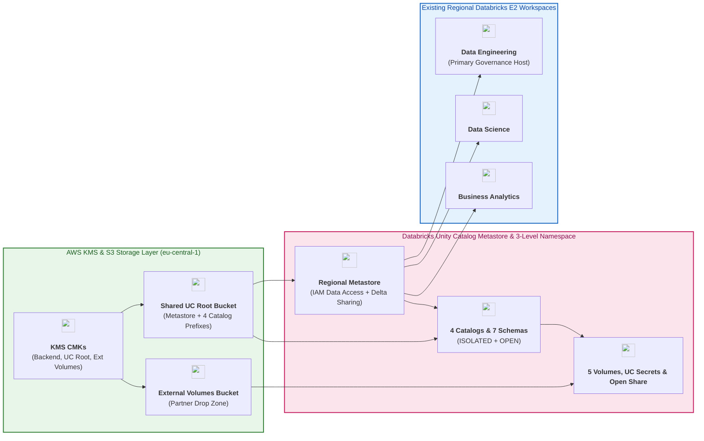
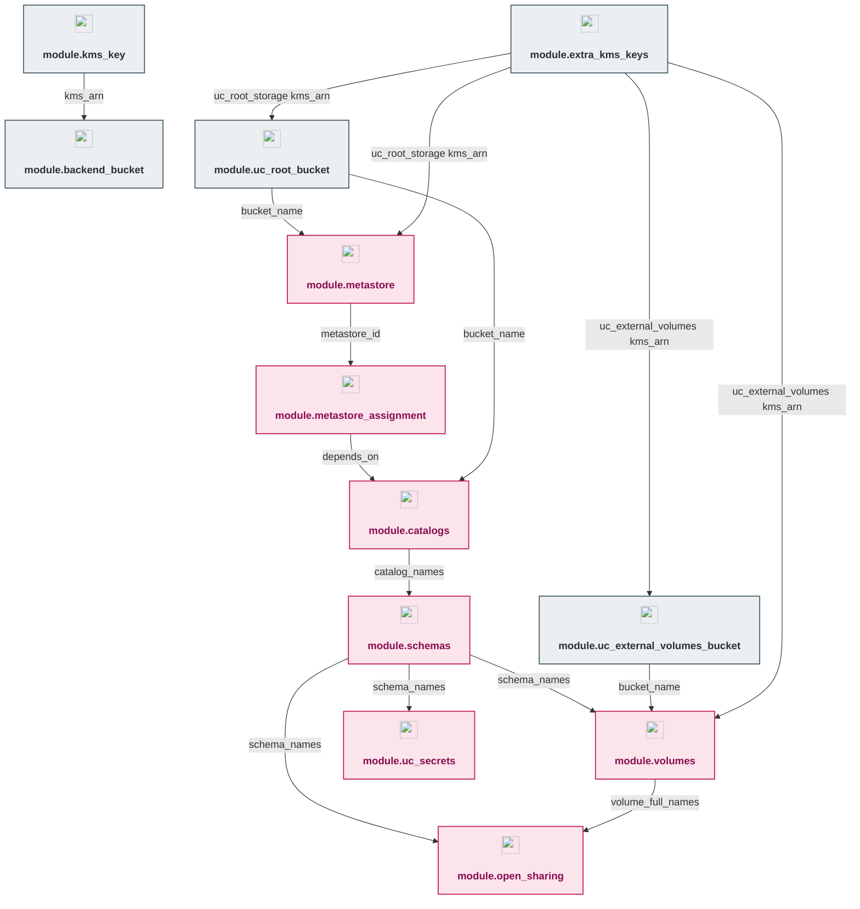

# Dev Environment — Databricks Unity Catalog Governance (`environments/dev`)

---

## 1. Executive Summary

- **Purpose & Scope**:
  This directory (`environments/dev`) is the root Terraform orchestration environment for deploying and governing **Databricks Unity Catalog** in the `dev` environment (`eu-central-1`). It unifies AWS cryptographic keys, hardened S3 storage buckets, the regional Unity Catalog metastore, multi-workspace assignments, domain-isolated and shared catalogs, medallion schemas, managed and external volumes, native Unity Catalog secrets, and Open Delta Sharing in a single declarative state.
- **Problem Statement & Solution**:
  Enterprise lakehouse deployments with multiple workspaces (`data_engineering`, `data_science`, `business_analytics`) require centralized metadata governance without proliferating S3 buckets per catalog or compute clusters per governance run. This environment solves this by:
  1. Discovering the 3 existing workspaces from `03_workspaces_and_compute_management` dynamically via `data.databricks_mws_workspaces.all` and binding them to a single regional metastore (`msedek-dbx-dep-uc-metastore-eu-central-1-dev`).
  2. Using a single shared Unity Catalog root S3 bucket (`msedek-dbx-dep-uc-metastore-root-dev`) with per-catalog S3 prefix roots (`s3://<bucket>/catalogs/<domain>`), plus a dedicated non-overlapping external volumes bucket (`msedek-dbx-dep-uc-ext-volumes-dev`).
  3. Executing all workspace-scoped Unity Catalog governance operations through the primary governance workspace (`https://dbc-273d0704-3b96.cloud.databricks.com`) with **zero extra compute clusters provisioned**.
- **Key Business & Security Outcomes**:
  - **End-to-End 3-Level Namespace Governance**: Governs Catalogs $\rightarrow$ Schemas $\rightarrow$ Volumes & Secrets under account-level SCIM groups (`dbx-platform-admins`, `dbx-data-engineers`, `dbx-data-scientists`, `dbx-data-analysts`).
  - **Workspace Isolation & Cross-Domain Sharing**: Enforces `ISOLATED` workspace bindings (`READ_WRITE` / `READ_ONLY`) on domain catalogs (`data_engineering_dev`, `data_science_dev`, `business_analytics_dev`) and `OPEN` access on `shared_enterprise_dev`.
  - **Customer-Managed KMS Envelope Encryption**: Separate KMS CMKs protect the Terraform backend state (`kms_key`), the UC root bucket (`extra_kms_keys["uc_root_storage"]`), and the external volumes bucket (`extra_kms_keys["uc_external_volumes"]`).
  - **Open Delta Sharing Ready**: Publishes live schemas and volumes to external token-authenticated recipients (`TOKEN`).

---

## 2. General Logic & Operational Flow

### 2.1 Configuration & Provisioning Lifecycle
1. **Dynamic Workspace Discovery (`data.tf` & `locals.tf`)**: Queries `data.databricks_mws_workspaces.all` (using `provider = databricks.mws`) to resolve workspace names (`msedek-dbx-dep-data-eng-dev`, `msedek-dbx-dep-data-science-dev`, `msedek-dbx-dep-data-analytics-dev`) to numeric workspace IDs (`local.workspace_ids`).
2. **State & Cryptographic Foundation**:
   - `module.kms_key` & `module.backend_bucket`: Retain the existing KMS CMK and S3 remote state bucket (`msedek-dbx-dep-unity-catalog-s3-backend-dev`).
   - `module.extra_kms_keys`: Provisions dedicated CMKs for `uc_root_storage` and `uc_external_volumes`.
3. **S3 Storage Layer**:
   - `module.uc_root_bucket`: Provisions `msedek-dbx-dep-uc-metastore-root-dev` (shared by the metastore and all catalog `storage_root` prefixes).
   - `module.uc_external_volumes_bucket`: Provisions `msedek-dbx-dep-uc-ext-volumes-dev` (dedicated to `EXTERNAL` volumes to respect the Unity Catalog non-overlapping path rule).
4. **Account-Level Metastore & Workspace Binding**:
   - `module.metastore`: Provisions the IAM role, S3/KMS policy, KMS grant, 30s STS propagation sleep, `databricks_metastore`, and `databricks_metastore_data_access`.
   - `module.metastore_assignment`: Assigns the metastore to all 3 regional workspaces.
5. **Workspace-Level 3-Level Namespace & Sharing**:
   - `module.catalogs` $\rightarrow$ `module.schemas` $\rightarrow$ `module.volumes`, `module.uc_secrets`, and `module.open_sharing`.

### 2.2 Data & Governance Plane Flow
- **Account Control Plane (`databricks.mws`)**: Authenticates to `https://accounts.cloud.databricks.com` to manage the regional metastore and workspace assignments.
- **Workspace Control Plane (`databricks.workspace`)**: Authenticates to `local.governance_workspace_url` (dynamically discovered via `data.databricks_current_user.data_engineering.workspace_url` with optional override via `var.governance_workspace_url`) to provision catalogs, workspace bindings, schemas, volumes, UC secrets, shares, recipients, and RBAC grants.

---

## 3. Architecture of the Environment

### 3.1 Catalogs, Workspace Bindings & Storage Topology

| Catalog Name | Isolation Mode | Storage Root Prefix (Shared UC Root Bucket) | Bound Workspaces (`READ_WRITE` / `READ_ONLY`) | Schemas Provisioned |
|:---|:---:|:---|:---|:---|
| `data_engineering_dev` | `ISOLATED` | `s3://msedek-dbx-dep-uc-metastore-root-dev/catalogs/data_engineering` | DE (`RW`), DS (`RO`), BA (`RO`) | `raw_ingestion`, `curated_silver` |
| `data_science_dev` | `ISOLATED` | `s3://msedek-dbx-dep-uc-metastore-root-dev/catalogs/data_science` | DS (`RW`), DE (`RO`) | `feature_store`, `model_artifacts` |
| `business_analytics_dev` | `ISOLATED` | `s3://msedek-dbx-dep-uc-metastore-root-dev/catalogs/business_analytics` | BA (`RW`), DE (`RW`) | `reporting_gold` |
| `shared_enterprise_dev` | `OPEN` | `s3://msedek-dbx-dep-uc-metastore-root-dev/catalogs/shared_enterprise` | All Attached Workspaces (`OPEN`) | `security_vault`, `open_sharing_outbox` |

### 3.2 Volumes, Secrets & Open Sharing Inventory

| Category | Object Identifier | Type / Scope | Backing Location / Target | Authorized Principals |
|:---|:---|:---:|:---|:---|
| **Volume** | `data_engineering_dev.raw_ingestion.autoloader_landing_zone` | `MANAGED` | Shared UC Root Bucket | `dbx-data-engineers` (RW) |
| **Volume** | `data_engineering_dev.raw_ingestion.partner_external_drop` | `EXTERNAL` | `s3://msedek-dbx-dep-uc-ext-volumes-dev/external-volumes/partner-drop` | `dbx-data-engineers` (RW) |
| **Volume** | `data_science_dev.model_artifacts.training_checkpoints` | `MANAGED` | Shared UC Root Bucket | `dbx-data-scientists` (RW), `dbx-data-engineers` (RO) |
| **Volume** | `business_analytics_dev.reporting_gold.executive_report_exports` | `MANAGED` | Shared UC Root Bucket | `dbx-data-analysts` (RW), `dbx-data-engineers` (RW) |
| **Volume** | `shared_enterprise_dev.open_sharing_outbox.shared_data_files` | `MANAGED` | Shared UC Root Bucket | `dbx-data-engineers` (RW), `dbx-data-analysts` (RO) + Delta Share |
| **UC Secret** | `shared_enterprise_dev.security_vault.external_ingestion_api_key` | `databricks_secret_uc` | Unity Catalog Metastore | `dbx-data-engineers` (`READ_SECRET`), `dbx-data-scientists` (`READ_SECRET`) |
| **UC Secret** | `data_engineering_dev.raw_ingestion.erp_jdbc_password` | `databricks_secret_uc` | Unity Catalog Metastore | `dbx-data-engineers` (`READ_SECRET`) |
| **Delta Share** | `enterprise_open_partner_share_dev` | `databricks_share` | Shares `open_sharing_outbox` (`SCHEMA`) + `shared_data_files` (`VOLUME`) | `external_b2b_analytics_partner_dev` (`TOKEN` recipient) |

---

## 4. Architecture C4 Visualisation

### 4.1 Level 1: System Context Diagram

### 4.2 Level 2: Container Diagram (Storage, Metastore & Multi-Workspace Governance)

### 4.3 Level 3: Component Diagram (Terraform Module Orchestration)

---

## 5. All Modules Used with Short Summaries

### 5.1 Module Inventory Table

| Module Instance | Source Path | Primary Role / Responsibility |
|:---|:---|:---|
| `kms_key` | [`../../modules/02.security/001.kms_key`](../../modules/02.security/001.kms_key) | Customer-managed KMS key for Terraform S3 remote state encryption |
| `backend_bucket` | [`../../modules/03.storage/001.env_backend_bucket`](../../modules/03.storage/001.env_backend_bucket) | Versioned, SSE-KMS encrypted S3 bucket for Terraform state |
| `extra_kms_keys` | [`../../modules/02.security/001.kms_key`](../../modules/02.security/001.kms_key) | Dedicated CMKs for Unity Catalog root bucket (`uc_root_storage`) and external volumes (`uc_external_volumes`) |
| `uc_root_bucket` | [`../../modules/03.storage/002.uc_root_bucket`](../../modules/03.storage/002.uc_root_bucket) | Shared Unity Catalog S3 root bucket (`msedek-dbx-dep-uc-metastore-root-dev`) |
| `uc_external_volumes_bucket` | [`../../modules/03.storage/002.uc_root_bucket`](../../modules/03.storage/002.uc_root_bucket) | Dedicated S3 bucket (`msedek-dbx-dep-uc-ext-volumes-dev`) for `EXTERNAL` volumes |
| `metastore` | [`../../modules/04.unity_catalog/001.metastore`](../../modules/04.unity_catalog/001.metastore) | Regional Unity Catalog metastore, IAM data access role, KMS grant, and Delta Sharing config |
| `metastore_assignment` | [`../../modules/04.unity_catalog/002.metastore_assignment`](../../modules/04.unity_catalog/002.metastore_assignment) | Binds the regional metastore to existing DE, DS, and BA workspaces |
| `catalogs` | [`../../modules/04.unity_catalog/003.catalogs`](../../modules/04.unity_catalog/003.catalogs) | Provisions 4 catalogs with shared-bucket S3 prefixes, workspace bindings, and RBAC grants |
| `schemas` | [`../../modules/04.unity_catalog/004.schemas`](../../modules/04.unity_catalog/004.schemas) | Provisions 7 medallion/domain schemas and authoritative schema RBAC grants |
| `volumes` | [`../../modules/04.unity_catalog/005.volumes`](../../modules/04.unity_catalog/005.volumes) | Provisions optional external storage credential/location and 5 `MANAGED` & `EXTERNAL` volumes |
| `uc_secrets` | [`../../modules/02.security/002.uc_secrets`](../../modules/02.security/002.uc_secrets) | Provisions native Unity Catalog secrets (`databricks_secret_uc`), RBAC grants, and workspace scope |
| `open_sharing` | [`../../modules/04.unity_catalog/006.open_sharing`](../../modules/04.unity_catalog/006.open_sharing) | Provisions Open Delta Sharing share, external `TOKEN` recipient, and `SELECT` grant |

---

## 6. Terraform Documentation Interface

> [!NOTE]
> The full machine-generated Terraform interface (Providers, Modules, Inputs, Outputs, and Resource definitions) is maintained by `terraform-docs` via pre-commit hooks in [`TERRAFORM.md`](./TERRAFORM.md).

### 6.1 Essential Inputs Summary

| Variable | Type | Description | Default / Sample |
|:---|:---:|:---|:---|
| `aws_region` | `string` | Target AWS region | `"eu-central-1"` |
| `aws_account_id` | `string` | 12-digit AWS Account ID (`sensitive = true`) | `"419259485595"` |
| `environment` | `string` | Deployment environment identifier | `"dev"` |
| `databricks_account_id` | `string` | Databricks Account UUID (`sensitive = true`) | `"1980a5a1-..."` |
| `service_principal_id` | `string` | OAuth M2M Service Principal Client ID | `"b6dd846d-..."` |
| `service_principal_secret` | `string` | OAuth M2M Service Principal Secret (`sensitive = true`) | `"***"` |
| `governance_workspace_url` | `string` | Optional override for primary workspace URL (dynamically resolved if null) | `null` |

### 6.2 Essential Outputs Summary

No root outputs are declared in `environments/dev` in accordance with output minimization rules.

---

## 7. Important Links and Resources

### 7.1 Authoritative Documentation
- [Databricks Unity Catalog Administration Guide (AWS)](https://docs.databricks.com/aws/en/data-governance/unity-catalog/) - Comprehensive guide to Unity Catalog on AWS.
- [Databricks Terraform Provider Documentation](https://registry.terraform.io/providers/databricks/databricks/latest/docs) - Provider resource reference.

### 7.2 Internal References
- [Terraform Contract (`TERRAFORM.md`)](./TERRAFORM.md)
- [Root Project Documentation (`../../README.md`)](../../README.md)
- [GitHub Actions CI/CD Workflows (`../../.github/workflows/README.md`)](../../.github/workflows/README.md)
- [Authoritative README Template (`../../.ai/README_TEMPLATE.md`)](../../.ai/README_TEMPLATE.md)
