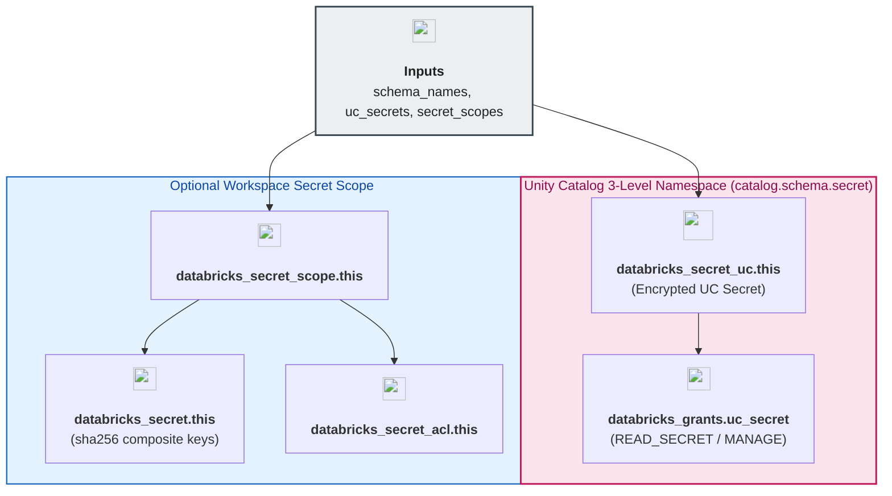

# Unity Catalog Secrets & Workspace Secret Scopes Module (`002.uc_secrets`)

---

## 1. Executive Summary

- **Purpose & Scope**:
  This module provisions native **Secrets in Unity Catalog** (`databricks_secret_uc`) governed within the 3-level namespace (`<catalog>.<schema>.<secret_name>`) alongside authoritative role-based access control grants (`databricks_grants` with `READ_SECRET` and `MANAGE` privileges). Additionally, it supports optional workspace-level Databricks secret scopes (`databricks_secret_scope`, `databricks_secret`, and `databricks_secret_acl`) for legacy notebook `dbutils.secrets.get()` workflows.
- **Problem Statement & Solution**:
  Traditional Databricks secret scopes are bound to a single workspace, requiring duplicate secret provisioning across Data Engineering, Data Science, and Analytics workspaces and lacking fine-grained schema-level governance. Native Unity Catalog secrets (`databricks_secret_uc`) solve this by storing encrypted credentials directly inside Unity Catalog schemas (`shared_enterprise_dev.security_vault.*` or `data_engineering_dev.raw_ingestion.*`), enabling cross-workspace secret consumption via the SQL `SECRET('<catalog>.<schema>', '<secret>')` function and standard `databricks_grants` RBAC.
- **Key Business & Security Outcomes**:
  - **Unified 3-Level Namespace Governance**: Credentials reside inside Unity Catalog schemas alongside tables and volumes under centralized audit logging.
  - **Least-Privilege Secret Access**: Fine-grained `READ_SECRET` and `MANAGE` grants restrict secret decryption to authorized account-level groups (`dbx-data-engineers`, `dbx-data-scientists`, `dbx-platform-admins`).
  - **State Sensitivity Protection & Hash-Based Resource Addressing**: Secret values are marked `sensitive = true` in Terraform input variables. For workspace secret scopes, resource addressing uses deterministic SHA256 hashes computed exclusively over non-sensitive composite keys (`sha256("${scope_name}/${secret_key}")`), completely eliminating `Invalid for_each argument: sensitive value` planning errors.
  - **Dual-Mode Compatibility**: Supports both modern Unity Catalog native secrets and optional workspace-scoped `DATABRICKS`-backed secret scopes.

---

## 2. General Logic & Operational Flow

### 2.1 Configuration & Provisioning Lifecycle
1. **Schema Reference Resolution**: Each entry in `var.uc_secrets` references a logical `schema_key` resolved from `var.schema_names` (output of `004.schemas`), guaranteeing that the parent catalog and schema exist before secret creation.
2. **Native UC Secret Creation**: Provisions `databricks_secret_uc.this` with `catalog_name`, `schema_name`, `name`, `value` (sensitive), `owner`, `comment`, and optional RFC3339 `expire_time`.
3. **Authoritative UC Secret Grants**: Filters secrets with non-empty `grants` in `locals.tf` (`local.uc_secrets_with_grants`) and provisions `databricks_grants.uc_secret` targeting `secret = databricks_secret_uc.this[each.key].full_name`.
4. **Deterministic Workspace Secret Addressing**: For optional workspace secret scopes (`var.secret_scopes`), `locals.tf` flattens scopes into `local.workspace_secrets` using a clean, non-sensitive hash key `sha256("${scope_key}/${secret_key}")` while keeping the secret value isolated in the value block. This ensures that `for_each = local.workspace_secrets` on `databricks_secret.this` and `databricks_secret_acl.this` executes cleanly without sensitive value leaks.

### 2.2 Secret Consumption Flow
- **SQL & Lakeflow / PySpark (Unity Catalog Secrets)**:
  `SELECT SECRET('shared_enterprise_dev.security_vault', 'external_ingestion_api_key');`
- **Legacy Notebooks (Workspace Secret Scopes)**:
  `dbutils.secrets.get(scope="uc-platform-integrations-dev", key="external_ingestion_api_key")`

---

## 3. Architecture of the Module

### 3.1 Provisioned Resources & Privilege Model

| Resource Type | Target Scope | Supported Privileges / Permissions | Purpose |
|:---|:---:|:---|:---|
| `databricks_secret_uc` | `<catalog>.<schema>.<name>` | Owned by secret `owner` or creator | Stores encrypted secret value in Unity Catalog |
| `databricks_grants` (`secret`) | `databricks_secret_uc.full_name` | `READ_SECRET`, `MANAGE`, `ALL_PRIVILEGES` | Authoritative RBAC grants for account groups |
| `databricks_secret_scope` | Workspace | `backend_type = "DATABRICKS"` | Optional workspace-local secret container |
| `databricks_secret` | Workspace Scope | Inherited from scope ACL | Stores key-value secret inside workspace scope |
| `databricks_secret_acl` | Workspace Scope | `READ`, `WRITE`, `MANAGE` | Workspace principal ACL on secret scope |

---

## 4. Architecture C4 Visualisation

### 4.1 Level 2: Component Diagram

---

## 5. All Modules Used with Short Summaries

This module does not invoke external submodules. It provisions native Databricks Unity Catalog and workspace secret resources directly.

- **Upstream Providers of Inputs**:
  - [`004.schemas`](../../04.unity_catalog/004.schemas) - Supplies `schema_names` map (`catalog_name` and `schema_name`) for 3-level namespace placement.
- **Consumers**:
  - [`environments/dev`](../../../environments/dev) - Root environment orchestrator instantiating this module.

---

## 6. Terraform Documentation Interface

> [!NOTE]
> Machine-generated interface specifications for this module are maintained by `terraform-docs` in [`TERRAFORM.md`](./TERRAFORM.md).

### 6.1 Essential Inputs Summary

| Variable | Type | Description | Required |
|:---|:---:|:---|:---:|
| `schema_names` | `map(object)` | Map of schema keys to `{catalog_name, schema_name, full_name}` from `004.schemas` | Yes |
| `uc_secrets` | `map(object)` | Map of Unity Catalog secrets (`databricks_secret_uc`) and RBAC grants (`sensitive = true`) | No (`{}`) |
| `secret_scopes` | `map(object)` | Optional map of workspace-level secret scopes, secrets, and ACLs (`sensitive = true`) | No (`{}`) |

### 6.2 Essential Outputs Summary

No outputs are exported by this module in accordance with output minimization principles (no downstream Terraform module consumes secret metadata).

---

## 7. Important Links and Resources

### 7.1 Authoritative Documentation
- [Terraform `databricks_secret_uc` Resource](https://registry.terraform.io/providers/databricks/databricks/latest/docs/resources/secret_uc) - Official Databricks provider documentation for Secrets in Unity Catalog.
- [Terraform `databricks_grants` Resource](https://registry.terraform.io/providers/databricks/databricks/latest/docs/resources/grants#secret-grants) - Unity Catalog secret privilege grant specification.
- [Databricks Secret Management Guide](https://docs.databricks.com/aws/en/security/secrets/) - Official Databricks documentation on secret management and `SECRET()` SQL function.

### 7.2 Internal References
- [Terraform Contract (`TERRAFORM.md`)](./TERRAFORM.md)
- [Unity Catalog Schemas Module (`004.schemas`)](../../04.unity_catalog/004.schemas)
- [Dev Environment Orchestrator (`environments/dev`)](../../../environments/dev)
- [Authoritative README Template](../../../.ai/README_TEMPLATE.md)
