# Unity Catalog Root & External Storage S3 Bucket Module (`002.uc_root_bucket`)

---

## 1. Executive Summary

- **Purpose & Scope**:
  This module provisions a hardened Amazon S3 bucket engineered specifically for **Databricks Unity Catalog storage**—supporting both the regional **Unity Catalog Metastore Root Bucket** (and shared catalog prefix roots) and **Optional External Volume Storage Buckets**.
- **Problem Statement & Solution**:
  Databricks Unity Catalog requires dedicated S3 object storage encrypted with Customer-Managed KMS Keys (SSE-KMS) and strict public access blocking, but—unlike Terraform state buckets—Databricks explicitly recommends **disabling S3 object versioning** on Unity Catalog buckets because Delta Lake and Unity Catalog natively manage table/volume transaction logs and `VACUUM` retention. Enabling S3 versioning on UC buckets leads to uncollected orphaned objects and inflated storage bills. This module codifies that exact posture while enforcing `BucketOwnerEnforced`, SSE-KMS with S3 Bucket Keys, `prevent_destroy = true`, and a 7-day incomplete multipart upload abort rule.
- **Key Business & Security Outcomes**:
  - **Shared Root Bucket Prefix Isolation**: Enables all catalogs (`data_engineering_dev`, `data_science_dev`, `data_analytics_dev`, `shared_enterprise_dev`) to use isolated `s3://<bucket>/catalogs/<domain>` prefixes inside a single governed UC root bucket without proliferating separate S3 buckets per catalog.
  - **Customer-Managed KMS Encryption (SSE-KMS)**: Enforces `aws:kms` encryption with `bucket_key_enabled = true` to reduce KMS API call costs by up to 99%.
  - **Delta Lake Storage Hygiene**: Sets S3 Versioning to `Disabled` per Databricks Unity Catalog best practices and aborts incomplete multipart uploads after 7 days.
  - **Zero Public Exposure & Deletion Guardrails**: Unconditionally blocks all public ACLs/policies and enforces `prevent_destroy = true`.

---

## 2. General Logic & Operational Flow

### 2.1 Configuration & Provisioning Lifecycle
1. **Bucket Naming Calculation**: Computes `local.full_bucket_name = "${var.bucket_name}-${var.environment}"` in `locals.tf`.
2. **S3 Bucket Creation**: Provisions `aws_s3_bucket.this` with `lifecycle { prevent_destroy = true }`.
3. **Ownership Enforcement**: Applies `aws_s3_bucket_ownership_controls.this` with `object_ownership = "BucketOwnerEnforced"`.
4. **Public Access Block**: Applies `aws_s3_bucket_public_access_block.this` with all four block flags set to `true`.
5. **Versioning Configuration**: Configures `aws_s3_bucket_versioning.this` with `status = "Disabled"` so Delta Lake `VACUUM` operations cleanly reclaim underlying S3 storage.
6. **SSE-KMS Encryption**: Configures `aws_s3_bucket_server_side_encryption_configuration.this` bound to `var.kms_key_arn` with `bucket_key_enabled = true`.
7. **Multipart Lifecycle Cleanup**: Configures `aws_s3_bucket_lifecycle_configuration.this` (`abort-incomplete-multipart-uploads`) to clean up failed multipart uploads after 7 days.

### 2.2 Storage Prefix Layout in `environments/dev`
- **Primary UC Root Bucket (`msedek-dbx-dep-uc-metastore-root-dev`)**:
  - `s3://msedek-dbx-dep-uc-metastore-root-dev/metastore` $\rightarrow$ Regional Metastore default root (`001.metastore`)
  - `s3://msedek-dbx-dep-uc-metastore-root-dev/catalogs/data_engineering_dev` $\rightarrow$ `data_engineering_dev` catalog (`003.catalogs`)
  - `s3://msedek-dbx-dep-uc-metastore-root-dev/catalogs/data_science_dev` $\rightarrow$ `data_science_dev` catalog (`003.catalogs`)
  - `s3://msedek-dbx-dep-uc-metastore-root-dev/catalogs/data_analytics_dev` $\rightarrow$ `data_analytics_dev` catalog (`003.catalogs`)
  - `s3://msedek-dbx-dep-uc-metastore-root-dev/catalogs/shared_enterprise_dev` $\rightarrow$ `shared_enterprise_dev` catalog (`003.catalogs`)
- **External Volume Bucket (`msedek-dbx-dep-uc-ext-volumes-dev`)**:
  - `s3://msedek-dbx-dep-uc-ext-volumes-dev/external-volumes/...` $\rightarrow$ Governed External Location for `EXTERNAL` volumes (`005.volumes`)

---

## 3. Architecture of the Module

### 3.1 Security & Storage Controls

| Control Layer | Resource Type | Setting | Architectural Justification |
|:---|:---|:---:|:---|
| **Encryption** | `aws_s3_bucket_server_side_encryption_configuration` | `aws:kms` (`bucket_key_enabled = true`) | Customer-managed CMK encryption with S3 Bucket Key optimization |
| **Access Boundary** | `aws_s3_bucket_public_access_block` | All 4 flags `true` | Complete isolation from public internet access |
| **Object Ownership** | `aws_s3_bucket_ownership_controls` | `BucketOwnerEnforced` | Disables legacy ACLs; bucket owner owns all objects written by UC |
| **S3 Versioning** | `aws_s3_bucket_versioning` | `status = "Disabled"` | Databricks UC best practice; Delta Lake manages time-travel & `VACUUM` |
| **Lifecycle Cleanup** | `aws_s3_bucket_lifecycle_configuration` | `days_after_initiation = 7` | Prevents orphaned multipart upload fragments |

---

## 4. Architecture C4 Visualisation

### 4.1 Level 2: Component Diagram

```mermaid
flowchart TD
    classDef input fill:#ECEFF1,stroke:#37474F,stroke-width:2px,color:#212121;
    classDef s3 fill:#E8F5E9,stroke:#2E7D32,stroke-width:1.5px,color:#1B5E20;
    classDef sec fill:#FFF8E1,stroke:#F57F17,stroke-width:1.5px,color:#E65100;
    classDef out fill:#E1F5FE,stroke:#0288D1,stroke-width:1.5px,color:#01579B;

    Inputs["<img src='https://raw.githubusercontent.com/mingrammer/diagrams/master/resources/aws/general/general.png' width='28' height='28' style='width:28px;height:28px;max-width:28px;max-height:28px;display:block;margin:0 auto;object-fit:contain;' /><br/><b>Inputs</b><br/>bucket_name, environment, kms_key_arn"]:::input
    S3Bucket["<img src='https://raw.githubusercontent.com/mingrammer/diagrams/master/resources/aws/storage/simple-storage-service-s3-bucket.png' width='36' height='36' style='width:36px;height:36px;max-width:36px;max-height:36px;display:block;margin:0 auto;object-fit:contain;' /><br/><b>aws_s3_bucket.this</b><br/>(prevent_destroy = true)"]:::s3
    Versioning["<img src='https://raw.githubusercontent.com/mingrammer/diagrams/master/resources/aws/storage/simple-storage-service-s3.png' width='28' height='28' style='width:28px;height:28px;max-width:28px;max-height:28px;display:block;margin:0 auto;object-fit:contain;' /><br/><b>aws_s3_bucket_versioning</b><br/>(Disabled for Delta Lake)"]:::s3
    Lifecycle["<img src='https://raw.githubusercontent.com/mingrammer/diagrams/master/resources/aws/storage/simple-storage-service-s3.png' width='28' height='28' style='width:28px;height:28px;max-width:28px;max-height:28px;display:block;margin:0 auto;object-fit:contain;' /><br/><b>aws_s3_bucket_lifecycle_configuration</b><br/>(7d Multipart Abort)"]:::s3
    Encryption["<img src='https://raw.githubusercontent.com/mingrammer/diagrams/master/resources/aws/security/key-management-service.png' width='28' height='28' style='width:28px;height:28px;max-width:28px;max-height:28px;display:block;margin:0 auto;object-fit:contain;' /><br/><b>aws_s3_bucket_server_side_encryption_configuration</b><br/>(SSE-KMS + Bucket Key)"]:::sec
    PublicBlock["<img src='https://raw.githubusercontent.com/mingrammer/diagrams/master/resources/aws/security/shield.png' width='28' height='28' style='width:28px;height:28px;max-width:28px;max-height:28px;display:block;margin:0 auto;object-fit:contain;' /><br/><b>aws_s3_bucket_public_access_block</b><br/>(100% Blocked)"]:::sec
    Ownership["<img src='https://raw.githubusercontent.com/mingrammer/diagrams/master/resources/aws/security/identity-and-access-management-iam-permissions.png' width='28' height='28' style='width:28px;height:28px;max-width:28px;max-height:28px;display:block;margin:0 auto;object-fit:contain;' /><br/><b>aws_s3_bucket_ownership_controls</b><br/>(BucketOwnerEnforced)"]:::sec
    OutputName["<img src='https://raw.githubusercontent.com/mingrammer/diagrams/master/resources/aws/general/general.png' width='28' height='28' style='width:28px;height:28px;max-width:28px;max-height:28px;display:block;margin:0 auto;object-fit:contain;' /><br/><b>Output: bucket_name</b>"]:::out

    Inputs --> S3Bucket
    S3Bucket --> Versioning
    S3Bucket --> Lifecycle
    S3Bucket --> Encryption
    S3Bucket --> PublicBlock
    S3Bucket --> Ownership
    S3Bucket --> OutputName
```

---

## 5. All Modules Used with Short Summaries

This module does not invoke external submodules. It provisions native Amazon S3 bucket resources directly.

- **Upstream Providers of Inputs**:
  - [`001.kms_key`](../../02.security/001.kms_key) - Provides `kms_arn` for S3 server-side encryption.
- **Consumers**:
  - [`001.metastore`](../../04.unity_catalog/001.metastore) - Consumes `bucket_name` for the regional metastore root storage and IAM policy generation.
  - [`003.catalogs`](../../04.unity_catalog/003.catalogs) - Consumes `bucket_name` to construct `s3://<bucket>/catalogs/<subpath>` managed storage roots for each catalog.
  - [`005.volumes`](../../04.unity_catalog/005.volumes) - Consumes the external volumes bucket `bucket_name` for external location registration.

---

## 6. Terraform Documentation Interface

> [!NOTE]
> Detailed interface contracts for this module are maintained by `terraform-docs` in [`TERRAFORM.md`](./TERRAFORM.md).

### 6.1 Essential Inputs Summary

| Variable | Type | Description | Required |
|:---|:---:|:---|:---:|
| `bucket_name` | `string` | Base name of the S3 bucket for Unity Catalog storage | Yes |
| `environment` | `string` | Deployment environment name (`dev`, `staging`, `prod`, `test`) | Yes |
| `kms_key_arn` | `string` | Customer-managed KMS key ARN used for SSE-KMS | Yes |
| `force_destroy` | `bool` | Whether all objects should be deleted when bucket is destroyed (`true`) | No |
| `tags` | `map(string)` | Additional resource tags | No |

### 6.2 Essential Outputs Summary

| Output | Type | Description | Downstream Consumer |
|:---|:---:|:---|:---|
| `bucket_name` | `string` | Name (`id`) of the provisioned Unity Catalog S3 bucket | `001.metastore`, `003.catalogs`, `005.volumes` |

---

## 7. Important Links and Resources

### 7.1 Authoritative Documentation
- [Create a Unity Catalog Metastore (AWS)](https://docs.databricks.com/aws/en/data-governance/unity-catalog/create-metastore) - Databricks S3 bucket and KMS requirements for Unity Catalog.
- [Amazon S3 Bucket Keys for SSE-KMS](https://docs.aws.amazon.com/AmazonS3/latest/userguide/bucket-key.html) - Reducing KMS request costs on S3 buckets.
- [Terraform AWS S3 Bucket Resource](https://registry.terraform.io/providers/hashicorp/aws/latest/docs/resources/s3_bucket) - AWS provider documentation.

### 7.2 Internal References
- [Terraform Contract (`TERRAFORM.md`)](./TERRAFORM.md)
- [KMS Key Module (`001.kms_key`)](../../02.security/001.kms_key)
- [Unity Catalog Metastore Module (`001.metastore`)](../../04.unity_catalog/001.metastore)
- [Unity Catalog Catalogs Module (`003.catalogs`)](../../04.unity_catalog/003.catalogs)
- [Authoritative README Template](../../../.ai/README_TEMPLATE.md)
