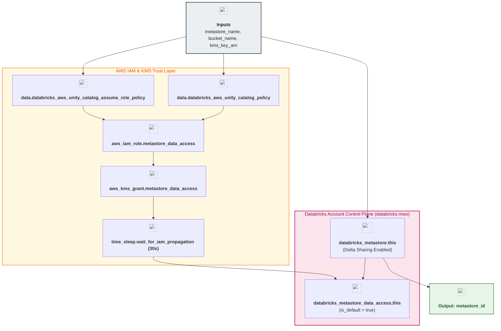

# Unity Catalog Regional Metastore & IAM Access Module (`001.metastore`)

---

## 1. Executive Summary

- **Purpose & Scope**:
  This module provisions the regional **Databricks Unity Catalog Metastore** (`databricks_metastore`), its default **Metastore Data Access Configuration** (`databricks_metastore_data_access`), and the complete **AWS IAM & KMS trust infrastructure** (`aws_iam_role`, `aws_iam_policy`, `aws_iam_role_policy_attachment`, `aws_kms_grant`, and `time_sleep` propagation safeguard) using the account-level `databricks.mws` provider alias.
- **Problem Statement & Solution**:
  Unity Catalog requires a regional metastore singleton that vends short-lived AWS STS credentials to compute engines accessing managed tables and volumes. However, creating the IAM role and immediately calling the Databricks Metastore Data Access API frequently fails due to AWS IAM eventual consistency and self-assume role validation checks. Furthermore, Open Delta Sharing cannot be enabled later on shares unless the metastore itself is configured with `delta_sharing_scope` and `delta_sharing_recipient_token_lifetime_in_seconds`. This module solves all three challenges by using authoritative Databricks IAM policy data sources (`data.databricks_aws_unity_catalog_assume_role_policy` and `data.databricks_aws_unity_catalog_policy`), inserting a 30-second `time_sleep` IAM propagation safeguard, and configuring Delta Sharing directly on the metastore.
- **Key Business & Security Outcomes**:
  - **Confused-Deputy Prevention**: Enforces `sts:ExternalId = var.databricks_account_id` and self-assuming role trust via `data.databricks_aws_unity_catalog_assume_role_policy`.
  - **Least-Privilege S3 & KMS Access**: Scopes IAM permissions strictly to the designated UC root bucket and KMS CMK (`kms_name = var.kms_key_arn`) plus an explicit `aws_kms_grant`.
  - **Centralized Metastore Governance**: Assigns `owner = var.owner_group_name` (`dbx-platform-admins`) so all platform administrators co-manage the metastore.
  - **Native Delta Sharing Readiness**: Configures `delta_sharing_scope = "INTERNAL_AND_EXTERNAL"` and token expiration governance at the metastore root.

---

## 2. General Logic & Operational Flow

### 2.1 Configuration & Provisioning Lifecycle
1. **IAM Trust & Permissions Generation**: Evaluates `data.databricks_aws_unity_catalog_assume_role_policy.this` (binding the Unity Catalog control plane principal `arn:aws:iam::414351767826:role/unity-catalog-prod-UCMasterRole-14S5ZJVKOTYTL` and self-assume ARN with `external_id`) and `data.databricks_aws_unity_catalog_policy.this` (scoping S3 actions and KMS key usage).
2. **AWS IAM Role & KMS Grant Creation**: Provisions `aws_iam_role.metastore_data_access`, `aws_iam_policy.metastore_data_access`, `aws_iam_role_policy_attachment.metastore_data_access`, and `aws_kms_grant.metastore_data_access`.
3. **Eventual Consistency Safeguard**: Waits 30 seconds via `time_sleep.wait_for_iam_propagation` after IAM policy attachment and KMS grant creation.
4. **Metastore Creation**: Creates `databricks_metastore.this` (`provider = databricks.mws`) with `storage_root = "s3://${var.bucket_name}/metastore"`, `owner = var.owner_group_name`, and Delta Sharing settings.
5. **Default Data Access Binding**: Creates `databricks_metastore_data_access.this` (`is_default = true`), linking the metastore to the IAM role ARN after `time_sleep` completes.

### 2.2 Short-Lived Credential Vending Flow
`[Databricks SQL / Compute Cluster]` $\rightarrow$ `[Unity Catalog Metastore Control Plane]` $\rightarrow$ `sts:AssumeRole (ExternalId = Databricks Account ID)` $\rightarrow$ `[aws_iam_role.metastore_data_access]` $\rightarrow$ `[SSE-KMS S3 Read/Write on UC Root Bucket]`.

---

## 3. Architecture of the Module

### 3.1 Provisioned Resources

| Resource / Data Source | Provider | Purpose |
|:---|:---:|:---|
| `data.databricks_aws_unity_catalog_assume_role_policy` | `databricks.mws` | Generates trust policy with `ExternalId` and self-assume statement |
| `data.databricks_aws_unity_catalog_policy` | `databricks.mws` | Generates least-privilege S3 & KMS permissions JSON |
| `aws_iam_role.metastore_data_access` | `aws` | IAM role assumed by Unity Catalog to vend scoped S3 credentials |
| `aws_iam_policy.metastore_data_access` | `aws` | Customer-managed IAM policy attached to the metastore role |
| `aws_kms_grant.metastore_data_access` | `aws` | Cryptographic grant allowing the IAM role to encrypt/decrypt with the UC CMK |
| `time_sleep.wait_for_iam_propagation` | `time` | 30s delay preventing `INVALID_STATE` validation failures during role assumption |
| `databricks_metastore.this` | `databricks.mws` | Regional Unity Catalog metastore container (`eu-central-1`) |
| `databricks_metastore_data_access.this` | `databricks.mws` | Default storage credential registered on the metastore |

---

## 4. Architecture C4 Visualisation

### 4.1 Level 2: Component Diagram

---

## 5. All Modules Used with Short Summaries

This module does not invoke external submodules.

- **Upstream Providers of Inputs**:
  - [`001.kms_key`](../../02.security/001.kms_key) - Provides `kms_arn` for the UC root storage CMK.
  - [`002.uc_root_bucket`](../../03.storage/002.uc_root_bucket) - Provides `bucket_name` for the metastore root location.
- **Consumers**:
  - [`002.metastore_assignment`](../002.metastore_assignment) - Consumes `metastore_id` to bind the metastore to existing Databricks workspaces.

---

## 6. Terraform Documentation Interface

> [!NOTE]
> Detailed interface contracts for this module are maintained by `terraform-docs` in [`TERRAFORM.md`](./TERRAFORM.md).

### 6.1 Essential Inputs Summary

| Variable | Type | Description | Required |
|:---|:---:|:---|:---:|
| `metastore_name` | `string` | Name of the regional Unity Catalog metastore | Yes |
| `aws_region` | `string` | AWS region where the metastore is provisioned (`eu-central-1`) | Yes |
| `aws_account_id` | `string` | 12-digit AWS Account ID (`sensitive = true`) | Yes |
| `databricks_account_id` | `string` | Databricks Account UUID (`sensitive = true`) | Yes |
| `bucket_name` | `string` | Base name of the S3 bucket used for the metastore root | Yes |
| `kms_key_arn` | `string` | ARN of the KMS key encrypting the UC root bucket | Yes |
| `iam_role_name` | `string` | Name of the IAM role assumed by Unity Catalog | Yes |
| `owner_group_name` | `string` | Account-level admin group owning the metastore (`dbx-platform-admins`) | Yes |
| `owner` | `string` | Optional explicit owner principal override | No (`null`) |
| `delta_sharing_scope` | `string` | Scope of Delta Sharing (`INTERNAL_AND_EXTERNAL`) | No |

### 6.2 Essential Outputs Summary

| Output | Type | Description | Downstream Consumer |
|:---|:---:|:---|:---|
| `metastore_id` | `string` | Unique identifier of the regional Unity Catalog metastore | `002.metastore_assignment` |

---

## 7. Important Links and Resources

### 7.1 Authoritative Documentation
- [Terraform `databricks_metastore` Resource](https://registry.terraform.io/providers/databricks/databricks/latest/docs/resources/metastore) - Metastore lifecycle and Delta Sharing attributes.
- [Terraform `databricks_metastore_data_access` Resource](https://registry.terraform.io/providers/databricks/databricks/latest/docs/resources/metastore_data_access) - Default metastore IAM credential binding.
- [Terraform `databricks_aws_unity_catalog_policy` Data Source](https://registry.terraform.io/providers/databricks/databricks/latest/docs/data-sources/aws_unity_catalog_policy) - Official IAM policy generator for Unity Catalog.

### 7.2 Internal References
- [Terraform Contract (`TERRAFORM.md`)](./TERRAFORM.md)
- [UC Root Bucket Module (`002.uc_root_bucket`)](../../03.storage/002.uc_root_bucket)
- [Metastore Assignment Module (`002.metastore_assignment`)](../002.metastore_assignment)
- [Authoritative README Template](../../../.ai/README_TEMPLATE.md)
