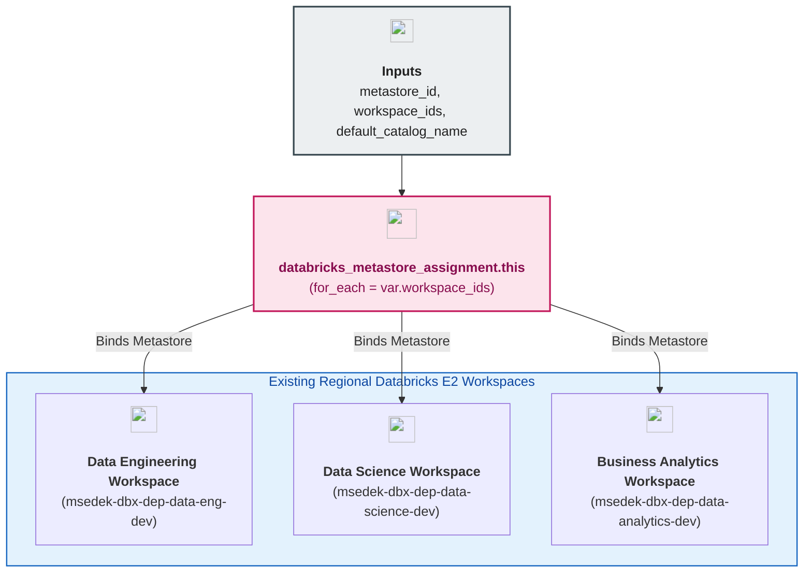

# Unity Catalog Workspace Metastore Assignment Module (`002.metastore_assignment`)

---

## 1. Executive Summary

- **Purpose & Scope**:
  This module attaches the regional **Databricks Unity Catalog Metastore** to all existing Databricks E2 workspaces in the region (`databricks_metastore_assignment` via `for_each = var.workspace_ids`) using the account-level `databricks.mws` provider alias.
- **Problem Statement & Solution**:
  A Unity Catalog metastore is an account-level regional object; until it is explicitly assigned to Databricks workspaces (`data_engineering`, `data_science`, `business_analytics`), workspace compute engines cannot resolve the 3-level namespace (`catalog.schema.table`) or execute workspace-scoped Unity Catalog APIs (such as creating catalogs, schemas, volumes, or Delta Sharing shares). This module binds the metastore across all target workspaces in parallel and establishes the prerequisite synchronization point before workspace-scoped governance modules execute.
- **Key Business & Security Outcomes**:
  - **Unified Multi-Workspace Governance**: Connects all regional workspaces to the single regional metastore so identities, catalogs, and lineage are shared seamlessly across Data Engineering, Data Science, and Business Analytics workspaces.
  - **Dynamic Workspace Discovery**: Accepts dynamically discovered workspace IDs (`data.databricks_mws_workspaces.all`) without hardcoding static workspace IDs in module code.
  - **Explicit Dependency Synchronization**: Serves as the `depends_on` gate for downstream catalog, schema, volume, secret, and Delta Sharing modules.

---

## 2. General Logic & Operational Flow

### 2.1 Configuration & Provisioning Lifecycle
1. **Dynamic Workspace Mapping**: Receives `var.workspace_ids` (a map of logical workspace keys to numeric workspace IDs discovered via `data.databricks_mws_workspaces.all` in `environments/dev`).
2. **Account-Level Assignment**: Iterates with `for_each = var.workspace_ids` to provision `databricks_metastore_assignment.this` using `provider = databricks.mws`, setting `metastore_id = var.metastore_id`, `workspace_id = each.value`, and `default_catalog_name = var.default_catalog_name`.
3. **Downstream Gate**: Once completed, all attached workspaces have Unity Catalog enabled and can execute workspace-level Unity Catalog API calls.

### 2.2 Workspace Attachment Topology (`environments/dev`)
- `data_engineering` (`msedek-dbx-dep-data-eng-dev` / `7474645771128190`) $\rightarrow$ Assigned to regional metastore
- `data_science` (`msedek-dbx-dep-data-science-dev` / `7474648085645767`) $\rightarrow$ Assigned to regional metastore
- `business_analytics` (`msedek-dbx-dep-data-analytics-dev` / `7474660556461653`) $\rightarrow$ Assigned to regional metastore

---

## 3. Architecture of the Module

### 3.1 Resource Breakdown

| Resource Type | Resource Identifier | Provider Alias | Key Attributes |
|:---|:---|:---:|:---|
| `databricks_metastore_assignment` | `this[each.key]` | `databricks.mws` | `metastore_id`, `workspace_id`, `default_catalog_name` |

---

## 4. Architecture C4 Visualisation

### 4.1 Level 2: Component Diagram

---

## 5. All Modules Used with Short Summaries

This module does not invoke external submodules.

- **Upstream Providers of Inputs**:
  - [`001.metastore`](../001.metastore) - Supplies `metastore_id`.
- **Downstream Dependents**:
  - [`003.catalogs`](../003.catalogs) - Waits on `module.metastore_assignment` via `depends_on` before creating catalogs and workspace bindings.

---

## 6. Terraform Documentation Interface

> [!NOTE]
> Detailed interface contracts for this module are maintained by `terraform-docs` in [`TERRAFORM.md`](./TERRAFORM.md).

### 6.1 Essential Inputs Summary

| Variable | Type | Description | Required |
|:---|:---:|:---|:---:|
| `metastore_id` | `string` | Unique identifier of the regional Unity Catalog metastore | Yes |
| `workspace_ids` | `map(string)` | Map of logical workspace keys to numeric Databricks workspace IDs | Yes |
| `default_catalog_name` | `string` | Default catalog name configured on assigned workspaces (`main`) | No |

### 6.2 Essential Outputs Summary

No outputs are exported by this module in accordance with output minimization principles.

---

## 7. Important Links and Resources

### 7.1 Authoritative Documentation
- [Terraform `databricks_metastore_assignment` Resource](https://registry.terraform.io/providers/databricks/databricks/latest/docs/resources/metastore_assignment) - Assigning a Unity Catalog metastore to workspaces.
- [Enable a Workspace for Unity Catalog](https://docs.databricks.com/aws/en/data-governance/unity-catalog/enable-workspaces) - Databricks architectural guide.

### 7.2 Internal References
- [Terraform Contract (`TERRAFORM.md`)](./TERRAFORM.md)
- [Unity Catalog Metastore Module (`001.metastore`)](../001.metastore)
- [Unity Catalog Catalogs Module (`003.catalogs`)](../003.catalogs)
- [Authoritative README Template](../../../.ai/README_TEMPLATE.md)
