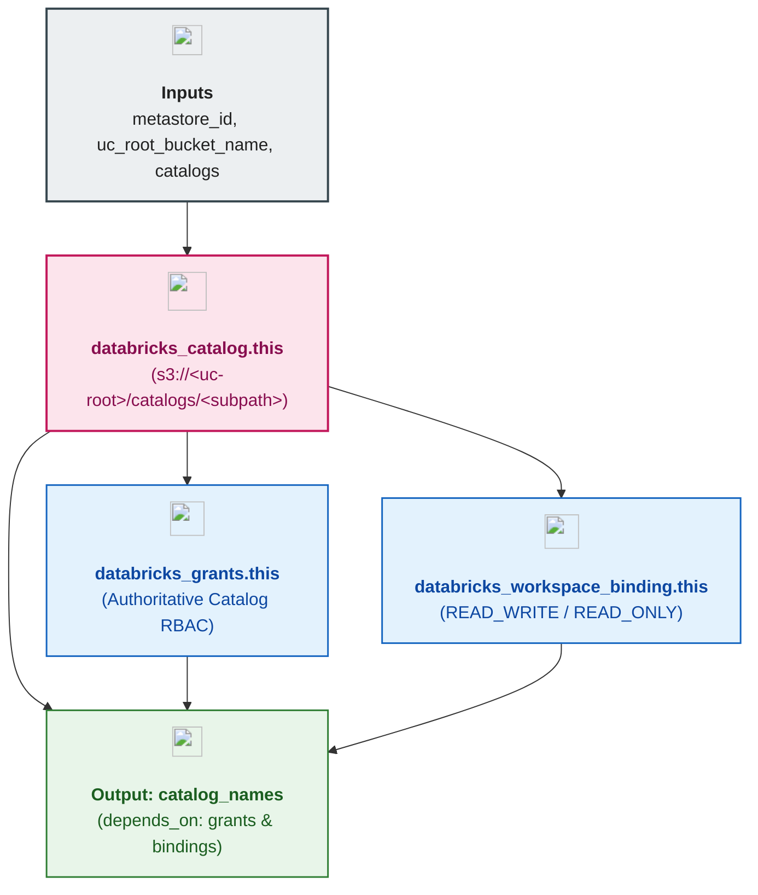

# Unity Catalog Catalogs, Workspace Bindings & RBAC Module (`003.catalogs`)

---

## 1. Executive Summary

- **Purpose & Scope**:
  This module provisions first-level **Unity Catalog Catalogs** (`databricks_catalog`), **Workspace-to-Catalog Bindings** (`databricks_workspace_binding`), and authoritative **Catalog RBAC Grants** (`databricks_grants`).
- **Problem Statement & Solution**:
  By default, catalogs in Unity Catalog (`isolation_mode = "OPEN"`) are visible to every workspace attached to the metastore, and omitting `storage_root` causes all catalogs to write into an undifferentiated metastore root directory. Conversely, creating a separate S3 bucket per catalog adds operational overhead when not yet required. This module solves both problems by:
  1. Assigning every catalog an isolated S3 prefix inside the shared Unity Catalog root bucket (`s3://${var.uc_root_bucket_name}/catalogs/${subpath}`)—satisfying the requirement **not to create separate S3 buckets per catalog** while preserving physical prefix separation.
  2. Enforcing `isolation_mode = "ISOLATED"` on domain-specific catalogs alongside `databricks_workspace_binding` (`BINDING_TYPE_READ_WRITE` for the owning workspace and `BINDING_TYPE_READ_ONLY` for cross-domain consumption workspaces).
- **Key Business & Security Outcomes**:
  - **Shared Root Bucket with Prefix Isolation**: Zero extra S3 buckets per catalog; clean S3 prefix boundaries (`s3://<uc-root-bucket>/catalogs/<domain>`).
  - **Workspace-Level Blast Radius Control**: `ISOLATED` catalogs (`data_engineering_dev`, `data_science_dev`, `business_analytics_dev`) can only be accessed from bound workspaces with explicit `READ_WRITE` or `READ_ONLY` binding modes, while `shared_enterprise_dev` uses `OPEN` mode for cross-workspace collaboration.
  - **Authoritative Group RBAC**: Uses `databricks_grants` to bind `USE_CATALOG`, `USE_SCHEMA`, `SELECT`, `MODIFY`, `CREATE_SCHEMA`, `CREATE_TABLE`, and `CREATE_VOLUME` privileges to account-level groups (`dbx-platform-admins`, `dbx-data-engineers`, `dbx-data-scientists`, `dbx-data-analysts`).
  - **Data-Flow Synchronization**: Accepts `var.metastore_id` directly from `module.metastore_assignment.metastore_id` and exports `output "catalog_names"` with output-level `depends_on = [databricks_grants.this, databricks_workspace_binding.this]`.

---

## 2. General Logic & Operational Flow

### 2.1 Configuration & Provisioning Lifecycle
1. **Locals Flattening**: `locals.tf` flattens `var.catalogs[*].workspace_bindings` into `local.catalog_workspace_bindings` and filters catalogs with non-empty `grants` into `local.catalogs_with_grants`.
2. **Catalog Provisioning**: Creates `databricks_catalog.this` with `storage_root = "s3://${var.uc_root_bucket_name}/catalogs/${coalesce(each.value.storage_subpath, each.key)}"`, `isolation_mode`, and `owner`.
3. **Workspace Binding Enforcement**: Creates `databricks_workspace_binding.this` for each entry in `local.catalog_workspace_bindings`, mapping `securable_type = "catalog"`, `securable_name`, `workspace_id`, and `binding_type` (`BINDING_TYPE_READ_WRITE` or `BINDING_TYPE_READ_ONLY`).
4. **Authoritative Grants**: Creates `databricks_grants.this` applying exact principal-privilege mappings to each catalog.

### 2.2 Catalog Governance Matrix (`environments/dev`)

| Catalog Key | Catalog Name | Isolation Mode | Storage Prefix in Shared UC Root Bucket | Workspace Bindings | Primary RBAC Groups |
|:---|:---|:---:|:---|:---|:---|
| `data_engineering` | `data_engineering_dev` | `ISOLATED` | `s3://<uc-root>/catalogs/data_engineering` | DE (`READ_WRITE`), DS (`READ_ONLY`), BA (`READ_ONLY`) | `dbx-data-engineers` (RW), `dbx-data-scientists` (RO), `dbx-data-analysts` (RO) |
| `data_science` | `data_science_dev` | `ISOLATED` | `s3://<uc-root>/catalogs/data_science` | DS (`READ_WRITE`), DE (`READ_ONLY`) | `dbx-data-scientists` (RW), `dbx-data-engineers` (RO) |
| `data_analytics` | `data_analytics_dev` | `ISOLATED` | `s3://<uc-root>/catalogs/data_analytics` | BA (`READ_WRITE`), DE (`READ_WRITE`) | `dbx-data-analysts` (RW), `dbx-data-engineers` (RW) |
| `shared_enterprise` | `shared_enterprise_dev` | `OPEN` | `s3://<uc-root>/catalogs/shared_enterprise` | All Workspaces (`OPEN`) | `dbx-data-engineers` (RW), `dbx-data-scientists` (RO), `dbx-data-analysts` (RO) |

---

## 3. Architecture of the Module

### 3.1 Provisioned Resources

| Resource Type | Resource Identifier | Purpose |
|:---|:---|:---|
| `databricks_catalog` | `this[each.key]` | Top-level Unity Catalog container with prefix-isolated `storage_root` |
| `databricks_workspace_binding` | `this[each.key]` | Binds `ISOLATED` catalogs to specific workspaces with `READ_WRITE` or `READ_ONLY` access |
| `databricks_grants` | `this[each.key]` | Authoritative RBAC privilege assignments on each catalog |

---

## 4. Architecture C4 Visualisation

### 4.1 Level 2: Component Diagram

---

## 5. All Modules Used with Short Summaries

This module does not invoke external submodules.

- **Upstream Providers of Inputs**:
  - [`002.uc_root_bucket`](../../03.storage/002.uc_root_bucket) - Supplies `uc_root_bucket_name` for catalog prefix storage roots.
  - [`002.metastore_assignment`](../002.metastore_assignment) - Supplies `metastore_id` directly to enforce data-flow dependency ordering without module-level `depends_on`.
- **Consumers**:
  - [`004.schemas`](../004.schemas) - Consumes `catalog_names` map to provision second-level schemas inside each catalog.

---

## 6. Terraform Documentation Interface

> [!NOTE]
> Detailed interface contracts for this module are maintained by `terraform-docs` in [`TERRAFORM.md`](./TERRAFORM.md).

### 6.1 Essential Inputs Summary

| Variable | Type | Description | Required |
|:---|:---:|:---|:---:|
| `uc_root_bucket_name` | `string` | Shared Unity Catalog S3 root bucket name | Yes |
| `metastore_id` | `string` | Parent Unity Catalog metastore ID to enforce implicit data-flow ordering | No (`null`) |
| `catalogs` | `map(object)` | Map of catalog definitions, isolation modes, workspace bindings, and RBAC grants | Yes |

### 6.2 Essential Outputs Summary

| Output | Type | Description | Downstream Consumer |
|:---|:---:|:---|:---|
| `catalog_names` | `map(string)` | Map of logical catalog keys to provisioned Unity Catalog names (with output-level `depends_on`) | `004.schemas` |

---

## 7. Important Links and Resources

### 7.1 Authoritative Documentation
- [Terraform `databricks_catalog` Resource](https://registry.terraform.io/providers/databricks/databricks/latest/docs/resources/catalog) - Catalog configuration and isolation modes.
- [Terraform `databricks_workspace_binding` Resource](https://registry.terraform.io/providers/databricks/databricks/latest/docs/resources/workspace_binding) - Workspace-to-catalog binding modes (`READ_WRITE`, `READ_ONLY`).
- [Limit Catalog Access to Specific Workspaces](https://docs.databricks.com/aws/en/catalogs/binding) - Databricks workspace binding documentation.

### 7.2 Internal References
- [Terraform Contract (`TERRAFORM.md`)](./TERRAFORM.md)
- [UC Root Bucket Module (`002.uc_root_bucket`)](../../03.storage/002.uc_root_bucket)
- [Unity Catalog Schemas Module (`004.schemas`)](../004.schemas)
- [Authoritative README Template](../../../.ai/README_TEMPLATE.md)
