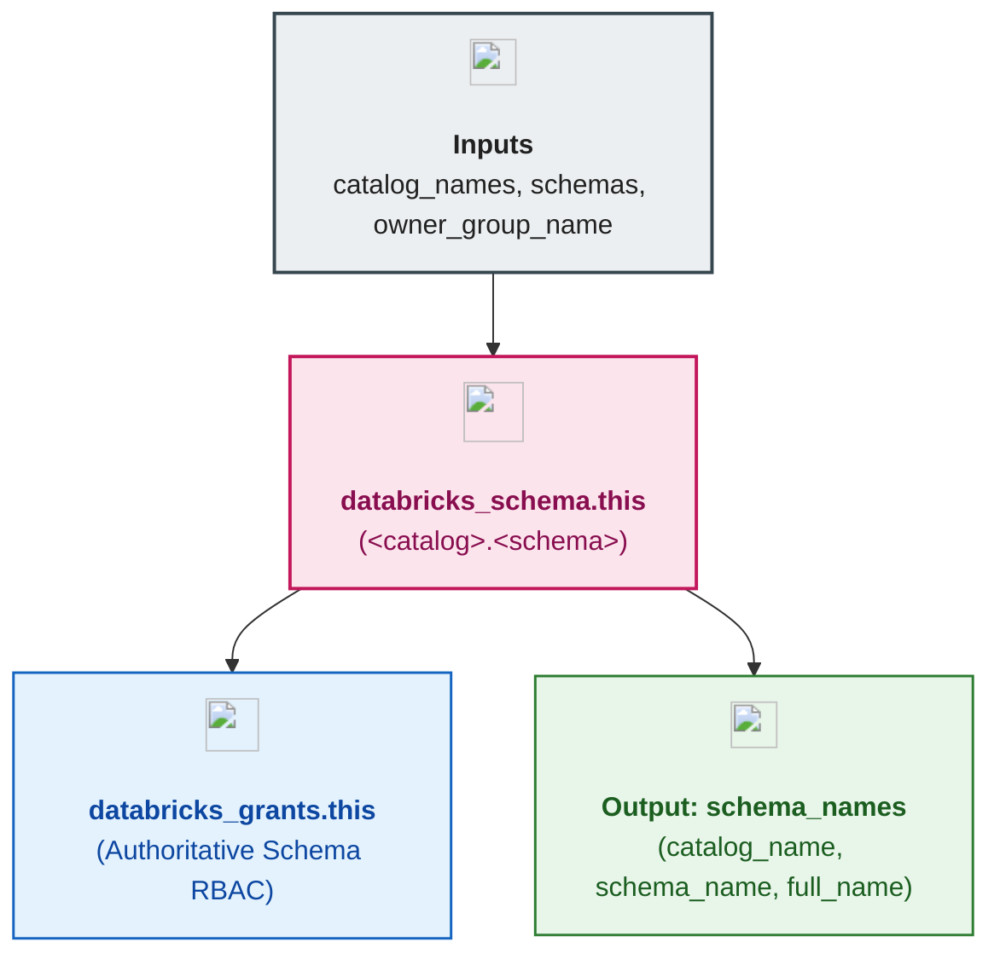

# Unity Catalog Schemas & RBAC Governance Module (`004.schemas`)

---

## 1. Executive Summary

- **Purpose & Scope**:
  This module provisions second-level **Unity Catalog Schemas** (`databricks_schema`) across all governed catalogs and enforces authoritative **Schema-Level Role-Based Access Control (RBAC)** (`databricks_grants`).
- **Problem Statement & Solution**:
  Within a catalog, different data layers (e.g., `raw_ingestion`, `curated_silver`, `feature_store`, `model_artifacts`, `reporting_gold`, `security_vault`, `open_sharing_outbox`) require distinct access boundaries—for instance, Data Engineers write to `raw_ingestion`, whereas Data Scientists and Analysts only consume curated or shared schemas. This module provisions the complete multi-layer schema taxonomy declaratively and binds authoritative `databricks_grants` (`USE_SCHEMA`, `SELECT`, `MODIFY`, `CREATE_TABLE`, `CREATE_VOLUME`, `CREATE_FUNCTION`, `CREATE_MODEL`, `READ_VOLUME`, `WRITE_VOLUME`) per schema.
- **Key Business & Security Outcomes**:
  - **Medallion & Domain Schema Taxonomy**: Establishes structured schemas for ingestion, transformation, ML feature/model storage, BI reporting, UC secret storage (`security_vault`), and Delta Sharing (`open_sharing_outbox`).
  - **Fine-Grained Schema RBAC**: Restricts write privileges (`MODIFY`, `CREATE_TABLE`, `WRITE_VOLUME`) to domain owners while granting read privileges (`USE_SCHEMA`, `SELECT`, `READ_VOLUME`) to downstream consumers.
  - **Structured Downstream Contract**: Exports `schema_names` (`catalog_name`, `schema_name`, `full_name`) consumed by `005.volumes`, `002.uc_secrets`, and `006.open_sharing`.

---

## 2. General Logic & Operational Flow

### 2.1 Configuration & Provisioning Lifecycle
1. **Catalog Key Resolution**: Resolves the parent `catalog_name` from `var.catalog_names[each.value.catalog_key]`, guaranteeing catalog creation before schema creation.
2. **Schema Provisioning**: Creates `databricks_schema.this` with `name`, `catalog_name`, `owner`, `comment`, `properties`, and `force_destroy`.
3. **Authoritative Grants**: Filters schemas with non-empty `grants` (`local.schemas_with_grants`) and applies `databricks_grants.this` (`schema = "${catalog_name}.${name}"`).

### 2.2 Provisioned Schema Taxonomy (`environments/dev`)

| Schema Key | Full Unity Catalog Name | Purpose | Primary RBAC Grants |
|:---|:---|:---|:---|
| `de_raw_ingestion` | `data_engineering_dev.raw_ingestion` | Bronze landing zone for raw files, volumes, and ERP ingestion secrets | `dbx-data-engineers` (RW + Volume/Table create) |
| `de_curated_silver` | `data_engineering_dev.curated_silver` | Cleansed and deduplicated Silver tables | `dbx-data-engineers` (RW), `dbx-data-scientists` (RO), `dbx-data-analysts` (RO) |
| `ds_feature_store` | `data_science_dev.feature_store` | ML feature tables and feature engineering pipelines | `dbx-data-scientists` (RW + Model/Function create), `dbx-data-engineers` (RO) |
| `ds_model_artifacts` | `data_science_dev.model_artifacts` | Model checkpoints, evaluation plots, and volume artifacts | `dbx-data-scientists` (RW + Volume create) |
| `ba_reporting_gold` | `business_analytics_dev.reporting_gold` | Executive Gold marts and BI semantic views | `dbx-data-analysts` (RW), `dbx-data-engineers` (RW) |
| `shared_security_vault` | `shared_enterprise_dev.security_vault` | Dedicated schema hosting native Unity Catalog secrets (`databricks_secret_uc`) | `dbx-data-engineers` (`USE_SCHEMA`), `dbx-data-scientists` (`USE_SCHEMA`) |
| `shared_open_sharing` | `shared_enterprise_dev.open_sharing_outbox` | Outbound tables and volumes published via Open Delta Sharing | `dbx-data-engineers` (RW), `dbx-data-analysts` (RO) |

---

## 3. Architecture of the Module

### 3.1 Provisioned Resources

| Resource Type | Resource Identifier | Purpose |
|:---|:---|:---|
| `databricks_schema` | `this[each.key]` | Second-level Unity Catalog namespace (`<catalog>.<schema>`) |
| `databricks_grants` | `this[each.key]` | Authoritative schema-level RBAC privilege bindings |

---

## 4. Architecture C4 Visualisation

### 4.1 Level 2: Component Diagram

---

## 5. All Modules Used with Short Summaries

This module does not invoke external submodules.

- **Upstream Providers of Inputs**:
  - [`003.catalogs`](../003.catalogs) - Supplies `catalog_names`.
- **Consumers**:
  - [`005.volumes`](../005.volumes) - Consumes `schema_names` to place managed and external volumes inside target schemas.
  - [`002.uc_secrets`](../../02.security/002.uc_secrets) - Consumes `schema_names` to place native Unity Catalog secrets inside target schemas.
  - [`006.open_sharing`](../006.open_sharing) - Consumes `schema_names` (via `locals.tf`) to share schemas externally via Delta Sharing.

---

## 6. Terraform Documentation Interface

> [!NOTE]
> Detailed interface contracts for this module are maintained by `terraform-docs` in [`TERRAFORM.md`](./TERRAFORM.md).

### 6.1 Essential Inputs Summary

| Variable | Type | Description | Required |
|:---|:---:|:---|:---:|
| `catalog_names` | `map(string)` | Map of logical catalog keys to catalog names from `003.catalogs` | Yes |
| `schemas` | `map(object)` | Map of schema definitions (`catalog_key`, `name`, `comment`, `properties`, `grants`) | Yes |
| `owner_group_name` | `string` | Default account-level admin group owning schemas (`dbx-platform-admins`) | No |

### 6.2 Essential Outputs Summary

| Output | Type | Description | Downstream Consumer |
|:---|:---:|:---|:---|
| `schema_names` | `map(object)` | Map of schema keys to `{catalog_name, schema_name, full_name}` | `005.volumes`, `002.uc_secrets`, `006.open_sharing` |

---

## 7. Important Links and Resources

### 7.1 Authoritative Documentation
- [Terraform `databricks_schema` Resource](https://registry.terraform.io/providers/databricks/databricks/latest/docs/resources/schema) - Unity Catalog schema resource specification.
- [Terraform `databricks_grants` Resource](https://registry.terraform.io/providers/databricks/databricks/latest/docs/resources/grants#schema-grants) - Schema-level privilege grant matrix.
- [What Are Schemas in Databricks?](https://docs.databricks.com/aws/en/schemas/) - Databricks Unity Catalog schema documentation.

### 7.2 Internal References
- [Terraform Contract (`TERRAFORM.md`)](./TERRAFORM.md)
- [Unity Catalog Catalogs Module (`003.catalogs`)](../003.catalogs)
- [Unity Catalog Volumes Module (`005.volumes`)](../005.volumes)
- [Unity Catalog Secrets Module (`002.uc_secrets`)](../../02.security/002.uc_secrets)
- [Authoritative README Template](../../../.ai/README_TEMPLATE.md)
