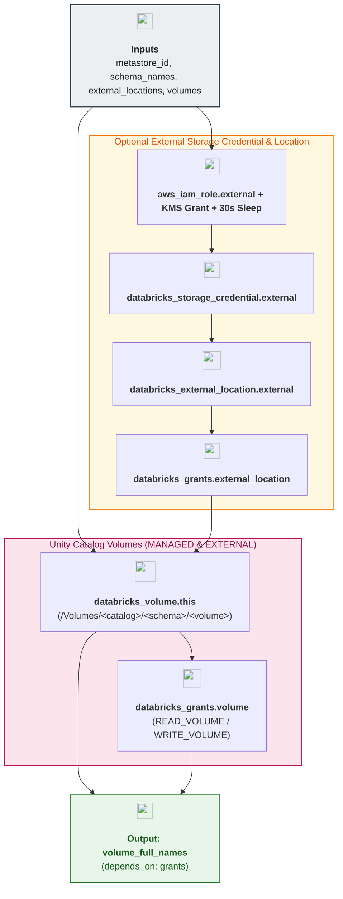

# Unity Catalog Volumes (Managed & Optional External) Module (`005.volumes`)

---

## 1. Executive Summary

- **Purpose & Scope**:
  This module provisions third-level **Unity Catalog Volumes** (`databricks_volume`)—supporting both **`MANAGED` Volumes** and optional **`EXTERNAL` Volumes**—along with the complete optional **Storage Credential & External Location** infrastructure (`aws_iam_role`, `aws_iam_policy`, `aws_kms_grant`, `time_sleep`, `databricks_storage_credential`, `databricks_external_location`, and authoritative `databricks_grants`).
- **Architecture Review & Design Rationale**:
  Before designing designated volumes, a comprehensive Unity Catalog storage architecture review was conducted against Databricks AWS best practices:
  1. **Unity Catalog Non-Overlap Rule**: Databricks strictly prohibits creating an `EXTERNAL` Location or `EXTERNAL` Volume whose S3 URI overlaps with the Metastore Root Bucket (`msedek-dbx-dep-uc-metastore-root-dev`) or any `MANAGED` catalog/schema storage root.
  2. **`MANAGED` Volumes by Default**: For internal file artifacts (Auto Loader landing zones, MLflow/PyTorch checkpoints, BI reference exports, and Delta Sharing outbox files), `MANAGED` volumes are the preferred default. Unity Catalog automatically stores them under the parent catalog's prefix in the shared UC root bucket (`s3://<uc-root-bucket>/catalogs/<domain>/...`) with zero extra IAM roles or external locations required.
  3. **Optional `EXTERNAL` Volumes on a Dedicated External Bucket**: When external cloud systems (SFTP drops, partner B2B feeds, AWS Lambda/EventBridge producers) must read/write raw files directly in S3 outside Databricks, an `EXTERNAL` volume is required. To satisfy the non-overlap rule cleanly, `var.external_locations` binds to a dedicated external volume bucket (`msedek-dbx-dep-uc-ext-volumes-dev`) encrypted with its own CMK (`uc_external_volumes`) and governed by a least-privilege `databricks_storage_credential` and `databricks_external_location`. If no external volumes are needed, `var.external_locations = {}` provisions zero extra IAM/credential resources.
- **Key Business & Security Outcomes**:
  - **POSIX-Style Governed File Access**: All volumes are accessible across clusters, SQL warehouses, and jobs via `/Volumes/<catalog>/<schema>/<volume_name>/` without mounting S3 buckets (`dbutils.fs.mount` is deprecated).
  - **Granular Volume RBAC**: Enforces `READ_VOLUME` and `WRITE_VOLUME` permissions per account group (`dbx-data-engineers`, `dbx-data-scientists`, `dbx-data-analysts`).
  - **Delta Sharing Volume Support**: Exports `volume_full_names` (`full_name` and `string_shared_as`) with encapsulated output-level `depends_on = [databricks_grants.volume, databricks_grants.external_location]` consumed by `006.open_sharing`.

---

## 2. General Logic & Operational Flow

### 2.1 Configuration & Provisioning Lifecycle
1. **Optional External Storage Credential & Location (`for_each = var.external_locations`)**:
   - Evaluates `data.databricks_aws_unity_catalog_assume_role_policy.external` and `data.databricks_aws_unity_catalog_policy.external`.
   - Creates `aws_iam_role.external`, `aws_iam_policy.external`, `aws_iam_role_policy_attachment.external`, and `aws_kms_grant.external`.
   - Waits 30 seconds via `time_sleep.wait_for_external_iam` for IAM eventual consistency.
   - Creates `databricks_storage_credential.external` and `databricks_external_location.external` (with explicit `sse_encryption_details` KMS ARN) and applies `databricks_grants.external_location` (`CREATE_EXTERNAL_VOLUME`, `READ_FILES`, `WRITE_FILES`).
2. **Volume Provisioning (`for_each = var.volumes`)**:
   - Resolves `catalog_name` and `schema_name` from `var.schema_names[each.value.schema_key]`.
   - For `MANAGED` volumes: sets `storage_location = null` (managed automatically by Unity Catalog).
   - For `EXTERNAL` volumes: sets `storage_location = "${databricks_external_location.external[each.value.external_location_key].url}/${subpath}"`.
3. **Authoritative Volume Grants**: Applies `databricks_grants.volume` (`READ_VOLUME`, `WRITE_VOLUME`) for each volume.

### 2.2 Designated Volumes Provisioned in `environments/dev`

| Volume Key | Full Unity Catalog Path (`/Volumes/...`) | Type | Backing Storage Location | Primary RBAC Groups |
|:---|:---|:---:|:---|:---|
| `de_raw_events_landing` | `/Volumes/data_engineering_dev/raw_ingestion/raw_events_landing` | `MANAGED` | Shared UC Root Bucket (`catalogs/data_engineering/...`) | `dbx-data-engineers` (`READ_VOLUME`, `WRITE_VOLUME`) |
| `de_partner_external_dropzone` | `/Volumes/data_engineering_dev/raw_ingestion/partner_external_dropzone` | `EXTERNAL` | External Bucket (`s3://msedek-dbx-dep-uc-ext-volumes-dev/external-volumes/partner-dropzone`) | `dbx-data-engineers` (`READ_VOLUME`, `WRITE_VOLUME`), `dbx-data-scientists` (`READ_VOLUME`) |
| `ds_model_checkpoints` | `/Volumes/data_science_dev/ml_artifacts/model_checkpoints` | `MANAGED` | Shared UC Root Bucket (`catalogs/data_science/...`) | `dbx-data-scientists` (`READ_VOLUME`, `WRITE_VOLUME`), `dbx-data-engineers` (`READ_VOLUME`) |
| `da_report_exports` | `/Volumes/data_analytics_dev/bi_reporting/report_exports` | `MANAGED` | Shared UC Root Bucket (`catalogs/data_analytics/...`) | `dbx-data-analysts` (`READ_VOLUME`, `WRITE_VOLUME`), `dbx-data-engineers` (`READ_VOLUME`, `WRITE_VOLUME`) |
| `shared_partner_releases` | `/Volumes/shared_enterprise_dev/external_sharing/partner_data_releases` | `MANAGED` | Shared UC Root Bucket (`catalogs/shared_enterprise/...`) | `dbx-data-engineers` (`READ_VOLUME`, `WRITE_VOLUME`), `dbx-data-analysts` (`READ_VOLUME`) + Delta Sharing |

---

## 3. Architecture of the Module

### 3.1 Provisioned Resources

| Resource Type | Resource Identifier | Condition | Purpose |
|:---|:---|:---:|:---|
| `aws_iam_role` / `aws_iam_policy` / `aws_kms_grant` | `external[each.key]` | `var.external_locations` non-empty | IAM role & KMS grant for external volume bucket |
| `time_sleep` | `wait_for_external_iam[each.key]` | `var.external_locations` non-empty | 30s STS propagation safeguard |
| `databricks_storage_credential` | `external[each.key]` | `var.external_locations` non-empty | Registers IAM role in Unity Catalog |
| `databricks_external_location` | `external[each.key]` | `var.external_locations` non-empty | Governs S3 URI prefix for external volumes |
| `databricks_grants` | `external_location[each.key]` | `var.external_locations` with grants | Grants `CREATE_EXTERNAL_VOLUME`, `READ_FILES`, `WRITE_FILES` |
| `databricks_volume` | `this[each.key]` | Always (`for_each = var.volumes`) | Creates `MANAGED` and `EXTERNAL` volumes |
| `databricks_grants` | `volume[each.key]` | Volumes with grants | Grants `READ_VOLUME` and `WRITE_VOLUME` |

---

## 4. Architecture C4 Visualisation

### 4.1 Level 2: Component Diagram

---

## 5. All Modules Used with Short Summaries

This module does not invoke external submodules.

- **Upstream Providers of Inputs**:
  - [`002.metastore_assignment`](../002.metastore_assignment) - Supplies `metastore_id` directly to enforce clean data-flow ordering.
  - [`004.schemas`](../004.schemas) - Supplies `schema_names`.
  - [`002.uc_root_bucket`](../../03.storage/002.uc_root_bucket) - Supplies `bucket_name` for the optional external volumes bucket.
  - [`001.kms_key`](../../02.security/001.kms_key) - Supplies `kms_arn` (`uc_external_volumes`) for external location SSE-KMS encryption.
- **Consumers**:
  - [`006.open_sharing`](../006.open_sharing) - Consumes `volume_full_names` (via `locals.tf`) to publish volumes through Open Delta Sharing.

---

## 6. Terraform Documentation Interface

> [!NOTE]
> Detailed interface contracts for this module are maintained by `terraform-docs` in [`TERRAFORM.md`](./TERRAFORM.md).

### 6.1 Essential Inputs Summary

| Variable | Type | Description | Required |
|:---|:---:|:---|:---:|
| `metastore_id` | `string` | Regional Unity Catalog metastore ID establishing data-flow dependency | Yes |
| `aws_account_id` | `string` | 12-digit AWS Account ID (`sensitive = true`) | Yes |
| `databricks_account_id` | `string` | Databricks Account UUID (`sensitive = true`) | Yes |
| `schema_names` | `map(object)` | Map of schema keys to `{catalog_name, schema_name, full_name}` from `004.schemas` | Yes |
| `external_locations` | `map(object)` | Optional map of external S3 locations to provision for `EXTERNAL` volumes | No (`{}`) |
| `volumes` | `map(object)` | Map of `MANAGED` and `EXTERNAL` volumes and their RBAC grants | Yes |
| `owner_group_name` | `string` | Default account-level admin group owning volumes (`dbx-platform-admins`) | No |

### 6.2 Essential Outputs Summary

| Output | Type | Description | Downstream Consumer |
|:---|:---:|:---|:---|
| `volume_full_names` | `map(object)` | Map of volume keys to `{full_name, string_shared_as}` with output-level `depends_on = [databricks_grants.volume, databricks_grants.external_location]` | `006.open_sharing` |

---

## 7. Important Links and Resources

### 7.1 Authoritative Documentation
- [What Are Unity Catalog Volumes?](https://docs.databricks.com/aws/en/volumes/) - Managed vs. external volumes architecture guide.
- [Terraform `databricks_volume` Resource](https://registry.terraform.io/providers/databricks/databricks/latest/docs/resources/volume) - Volume resource arguments.
- [Terraform `databricks_external_location` Resource](https://registry.terraform.io/providers/databricks/databricks/latest/docs/resources/external_location) - External location resource arguments.

### 7.2 Internal References
- [Terraform Contract (`TERRAFORM.md`)](./TERRAFORM.md)
- [Unity Catalog Schemas Module (`004.schemas`)](../004.schemas)
- [Open Delta Sharing Module (`006.open_sharing`)](../006.open_sharing)
- [Authoritative README Template](../../../.ai/README_TEMPLATE.md)
