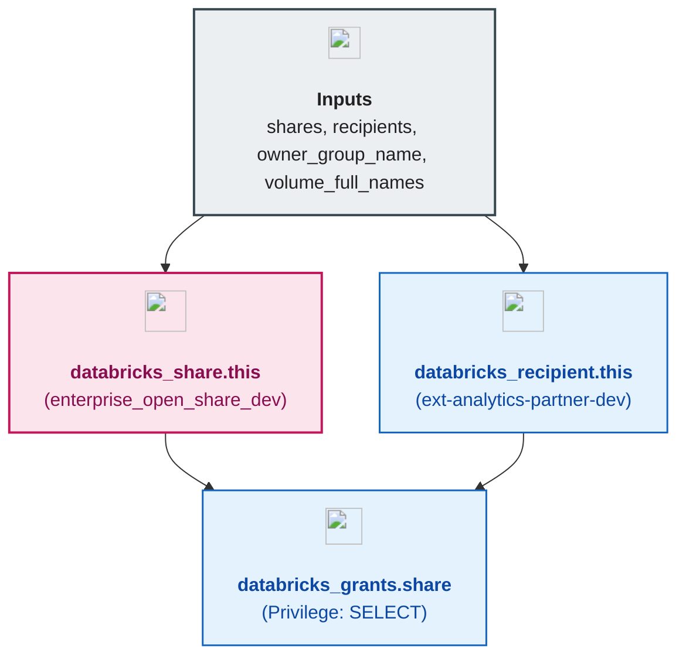

# Unity Catalog Open Delta Sharing Module (`006.open_sharing`)

---

## 1. Executive Summary

- **Purpose & Scope**:
  This module provisions a complete **Open Delta Sharing** baseline in Unity Catalog: **Delta Shares** (`databricks_share`), **External Token Recipients** (`databricks_recipient` with `authentication_type = "TOKEN"`), and **Share Access Grants** (`databricks_grants` with `SELECT` privileges).
- **Problem Statement & Solution**:
  Sharing live data assets with external partners or non-Databricks consumers (such as Pandas, Apache Spark, Power BI, DuckDB, or Tableau) traditionally required copying CSV/Parquet files to external FTP servers or managing cross-account S3 bucket policies. Open Delta Sharing solves this by exposing live Unity Catalog schemas, tables, and volumes over the open Delta Sharing REST protocol using short-lived pre-signed S3 URLs and bearer token profiles—with zero data replication.
- **Key Business & Security Outcomes**:
  - **Zero-Copy External Data Sharing**: Shares curated volumes (`shared_enterprise_dev.external_sharing.partner_data_releases`) directly from the governed UC root bucket.
  - **Open Token Authentication (`TOKEN`)**: Enables external consumers without a Databricks workspace to authenticate via an activation link and `.share` credential file, guarded by metastore-level token expiration (`delta_sharing_recipient_token_lifetime_in_seconds`) and optional CIDR IP access lists (`ip_access_list`).
  - **Audited Share Grants**: Binds `SELECT` privileges on `databricks_share` to designated `databricks_recipient` identities via `databricks_grants`.
  - **Native Data-Flow Architecture**: Consumes volume references dynamically from `module.volumes.volume_full_names` passed as input (`var.volume_full_names`) without brittle module-level `depends_on = [module.volumes]` blocks.

---

## 2. General Logic & Operational Flow

### 2.1 Configuration & Provisioning Lifecycle
1. **Share Creation (`databricks_share.this`)**: Iterates over `var.shares` and constructs `object` blocks for shared Unity Catalog assets (`SCHEMA`, `TABLE`, `VOLUME`, or `MODEL`), dynamically resolving volume full names and `string_shared_as` via `var.volume_full_names` when `volume_key` is specified.
2. **Recipient Creation (`databricks_recipient.this`)**: Iterates over `var.recipients` and provisions Open Delta Sharing recipients (`authentication_type = "TOKEN"`), optional `sharing_code`, and optional `ip_access_list` CIDR allowlists.
3. **Share Grants (`databricks_grants.share`)**: Filters shares with non-empty `recipient_keys` (`local.shares_with_recipients`) and grants `privileges = ["SELECT"]` on `share = databricks_share.this[each.key].name` to each linked recipient.

### 2.2 Provisioned Delta Sharing Entities in `environments/dev`
- **Delta Share**: `enterprise_open_share_dev` (owned by `dbx-platform-admins`)
- **Shared Object**: `/Volumes/shared_enterprise_dev/external_sharing/partner_data_releases` (`data_object_type = "VOLUME"`, `string_shared_as = "external_sharing.partner_data_releases"`)
- **Open Recipient**: `ext-analytics-partner-dev` (`authentication_type = "TOKEN"`, `properties = { environment = "dev", tier = "external-partner" }`)
- **Privilege Grant**: `SELECT` privilege granted to `ext-analytics-partner-dev` on `enterprise_open_share_dev`

### 2.3 Open Delta Sharing Consumption Flow
`[External Consumer (Power BI / Pandas / Spark)]` $\rightarrow$ `[Delta Sharing Server (Databricks Control Plane) with Bearer Token]` $\rightarrow$ `[Validates Share Grant & Recipient IP List]` $\rightarrow$ `[Issues Short-Lived Pre-Signed S3 URL]` $\rightarrow$ `[Reads Delta Parquet / Volume Objects Directly from S3]`.

---

## 3. Architecture of the Module

### 3.1 Provisioned Resources

| Resource Type | Resource Identifier | Key Attributes | Purpose |
|:---|:---|:---|:---|
| `databricks_share` | `this[each.key]` | `name`, `owner`, `object { data_object_type, name, string_shared_as }` | Container of shared schemas, tables, and volumes |
| `databricks_recipient` | `this[each.key]` | `name`, `authentication_type = "TOKEN"`, `ip_access_list` | External consumer identity for Open Delta Sharing |
| `databricks_grants` | `share[each.key]` | `share`, `grant { principal, privileges = ["SELECT"] }` | Authorizes recipients to read from the share |

---

## 4. Architecture C4 Visualisation

### 4.1 Level 2: Component Diagram

---

## 5. All Modules Used with Short Summaries

This module does not invoke external submodules.

- **Upstream Providers of Inputs**:
  - [`001.metastore`](../001.metastore) - Enables `delta_sharing_scope = "INTERNAL_AND_EXTERNAL"` on the regional metastore.
  - [`005.volumes`](../005.volumes) - Supplies `volume_full_names` as direct module input (`volume_full_names = module.volumes.volume_full_names`) in `environments/dev/main.tf` to establish a direct, fine-grained data-flow dependency without module-level `depends_on`.
- **Consumers**:
  - [`environments/dev`](../../../environments/dev) - Root environment orchestrator.

---

## 6. Terraform Documentation Interface

> [!NOTE]
> Detailed interface contracts for this module are maintained by `terraform-docs` in [`TERRAFORM.md`](./TERRAFORM.md).

### 6.1 Essential Inputs Summary

| Variable | Type | Description | Required |
|:---|:---:|:---|:---:|
| `shares` | `map(object)` | Map of Delta Sharing shares, shared objects (`SCHEMA`, `VOLUME`, `TABLE`), and `recipient_keys` | No (`{}`) |
| `recipients` | `map(object)` | Map of Open Delta Sharing recipients (`authentication_type = "TOKEN"`, `allowed_ip_addresses`) | No (`{}`) |
| `owner_group_name` | `string` | Default account-level admin group owning shares and recipients (`dbx-platform-admins`) | Yes |
| `volume_full_names` | `map(object)` | Map of logical volume keys to volume identifiers (`full_name`, `string_shared_as`) exported by `005.volumes` | No (`{}`) |

### 6.2 Essential Outputs Summary

No outputs are exported by this module in accordance with output minimization principles.

---

## 7. Important Links and Resources

### 7.1 Authoritative Documentation
- [What Is Delta Sharing?](https://docs.databricks.com/aws/en/delta-sharing/) - Official Databricks Delta Sharing overview.
- [Terraform `databricks_share` Resource](https://registry.terraform.io/providers/databricks/databricks/latest/docs/resources/share) - Share resource configuration and `object` block specification.
- [Terraform `databricks_recipient` Resource](https://registry.terraform.io/providers/databricks/databricks/latest/docs/resources/recipient) - Open recipient (`TOKEN`) resource specification.

### 7.2 Internal References
- [Terraform Contract (`TERRAFORM.md`)](./TERRAFORM.md)
- [Unity Catalog Metastore Module (`001.metastore`)](../001.metastore)
- [Unity Catalog Volumes Module (`005.volumes`)](../005.volumes)
- [Authoritative README Template](../../../.ai/README_TEMPLATE.md)
